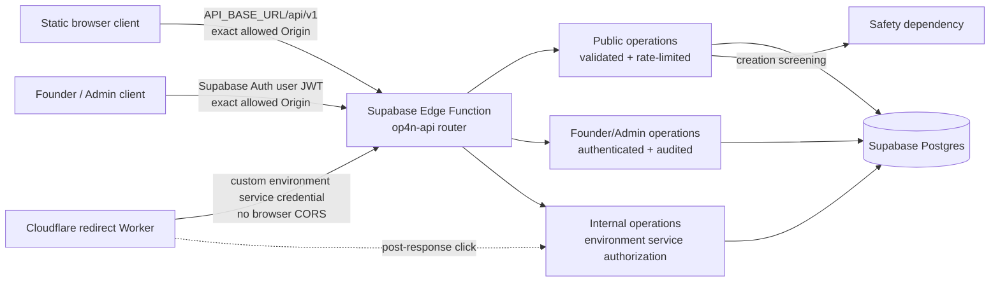

# R1 API contract and shared error model

- Status: Proposed for review
- Scope: Feature Inventory R1, Batch 1, Order 6
- Contract: [OpenAPI 3.1](./r1-openapi.yaml)
- Related architecture: [Production architecture](../architecture/r1-production-architecture.md)
- Related environments: [Environment strategy](../architecture/r1-environment-strategy.md)
- Related schema: [Database schema and invariants](../architecture/r1-database-schema.md)
- Decision owner and sole initial operator: Founder
- Last updated: 2026-11-08

## Purpose and non-goals

This document and the OpenAPI file are the R1 source of truth for REST/JSON
resource contracts, access boundaries, public data, shared errors,
idempotency, rate-limit classes, CORS, and environment readiness. They define
contracts only. They do not create or deploy a Supabase Edge Function,
Cloudflare Worker, route, DNS record, CORS configuration, secret, database
migration, project, workflow, or hosted frontend.

R1 exposes no Registered-owner or ownership-management API, custom alias
behavior, detailed analytics, pricing, Paid, Premium, or quota product.

## API topology and environment contract

One Supabase Edge Function router named `op4n-api` is deployed separately per
hosted environment. The non-secret client configuration has this shape:

```text
API_BASE_URL=https://<environment-project-ref>.supabase.co/functions/v1/op4n-api
resource base=${API_BASE_URL}/api/v1
```

`<environment-project-ref>` is an environment placeholder, not a real project
identifier. Deployment validation must substitute the expected project from
the protected environment configuration, prove that it belongs to the selected
environment, and reject placeholder, missing, cross-environment, or unexpected
values before deployment or verification. Project references, credentials, and
raw connection details are not retained in public configuration evidence.

| Environment | Frontend/client origin | API base | Canonical redirect entrypoint |
| --- | --- | --- | --- |
| Local workflow | `http://127.0.0.1:5500` | Local adapter or the approved Staging API during explicit integration testing | Local simulation only |
| Staging hosted | Planned `https://staging.op4n.com`; this Order does not create it | `https://<staging-project-ref>.supabase.co/functions/v1/op4n-api` | Planned `https://staging.op4n.me/{code}`; this Order does not create it |
| Production hosted | `https://op4n.com` on GitHub Pages | `https://<production-project-ref>.supabase.co/functions/v1/op4n-api` | `https://op4n.me/{code}` |

The API host is never GitHub Pages. Staging and Production use different
routers, project references, secrets, service authorization, logs, rate-limit
state, and data. The paths are stable across environments; the base URL is not.

## Request and trust-boundary flow



The Worker waits only for internal redirect lookup. It commits a valid `302`
before scheduling click recording. Analytics, Latest Links, exact lookup,
reporting, Admin operations, dashboards, and notifications are never
synchronous redirect dependencies.

## Authentication and function verification

The single `op4n-api` router contains public and protected routes, so a blanket
function-level JWT gate cannot express the contract. The deployed function must
allow requests to reach the router by setting platform function verification to
`verify_jwt = false` (or the supported equivalent), then enforce the following
mandatory route-level matrix before operation logic. This setting does not make
founder or internal routes public; a missing, ambiguous, or failed route check
returns `401` or `403` before data access.

| Route class | Caller credential | Mandatory route verification |
| --- | --- | --- |
| Public | No user JWT required | Method/content/body/schema validation, server-generated request ID, and configured public rate-limit class. Any supplied bearer token grants no additional capability. |
| Founder/Admin | Supabase Auth user JWT | Verify signature against the environment's trusted Supabase Auth keys; exact issuer and audience; expiration/not-before; expected environment/project context; then match stable JWT `sub` to the environment-scoped founder user-ID allowlist. Every mutation is audited. |
| Internal Worker/operations | Custom environment-scoped service credential | Verify using the environment's rotatable server-side credential set, constant-time comparison or approved cryptographic verification, explicit internal-operation scope, and Staging/Production separation. |

The founder JWT is a normal short-lived Supabase Auth user JWT, not a static
token embedded in the browser or frontend bundle. R1 has no public sign-up,
Registered-user API, or ownership-management route. A valid non-founder user JWT
has no founder authority.

The internal credential is not a Supabase Publishable key, Supabase Secret key,
or founder JWT. It is never accepted by public/Admin routes, never exposed to a
browser, and is independently issued and rotated for Staging and Production.
Authentication failures and logs never echo the credential or token claims.

## Endpoint inventory

All resource paths below are relative to `${API_BASE_URL}`. The server creates a
new opaque `X-Request-ID` for every request and includes it in every response and
error envelope. It never accepts or echoes a client-selected `X-Request-ID`.
The ID must not encode a link code, destination, project reference, user, or
report. A separate client correlation protocol such as `traceparent` is outside
Order 6.

| Method and path | Purpose | Access | Idempotency | Rate-limit class | Data class | Cache |
| --- | --- | --- | --- | --- | --- | --- |
| `POST /api/v1/links` | Create a screened Public Guest canonical link | Public | Required | `public-create` | Public request plus Protected destination | `no-store` |
| `GET /api/v1/links/{code}` | Read one eligible public Created Link card | Public | Not applicable | `public-read` | Public only | `no-store` |
| `GET /api/v1/links` | Return up to 100 eligible links, newest first | Public | Not applicable | `public-read` | Public only | `no-store` |
| `GET /api/v1/link-lookup` | Normalize a full short URL, host/path, or code and perform exact lookup | Public | Not applicable | `public-search` | Public input/output | `no-store` |
| `POST /api/v1/links/{code}/reports` | Persist a bounded public abuse report | Public | Required | `public-report` | Sensitive request; safe receipt | `no-store` |
| `GET /api/v1/admin/links/{code}` | Founder lookup for one canonical link | Founder/Admin | Not applicable | `admin-read` | Protected/Sensitive | `no-store` |
| `POST /api/v1/admin/links/{code}/disable` | Atomically disable and audit with a reason | Founder/Admin | Required | `admin-mutation` | Protected/Sensitive | `no-store` |
| `POST /api/v1/admin/links/{code}/restore` | Atomically restore and audit when safety permits | Founder/Admin | Required | `admin-mutation` | Protected/Sensitive | `no-store` |
| `POST /api/v1/internal/redirect-lookup` | Return the authoritative redirect decision for the Worker | Environment service | Not applicable; read-only | `internal-redirect` | Protected | `no-store` |
| `POST /api/v1/internal/clicks` | Accept one post-response click event identity | Environment service | Required; event identity is the deduplication identity | `internal-analytics` | Operational/Protected | `no-store` |
| `GET /api/v1/internal/health/live` | Prove the selected router process is responsive | Environment service | Not applicable | `operational-health` | Operational | `no-store` |
| `GET /api/v1/internal/health/ready` | Prove environment identity and required dependencies are ready | Environment service | Not applicable | `operational-health` | Operational | `no-store` |

Canonical code or URL knowledge never grants Admin, ownership, internal, or
service authority. Internal endpoints are not browser endpoints and return no
CORS headers.

## Public card allowlist

Every public Created Link, Latest item, and exact-lookup result uses one
`PublicLinkCard` representation containing only:

- `canonicalCode`;
- `displayTitle`, including the server-selected fallback when Title is absent;
- `canonicalShortUrl`;
- `canonicalOpenUrl`;
- `safeDestinationSummary`; and
- `aggregateTotalClicks`.

Both canonical URLs point to the environment's canonical redirect entrypoint,
never the protected destination. The browser Open action uses
`canonicalOpenUrl`, so destination resolution remains inside the redirect
service.

`safeDestinationSummary` contains a normalized HTTP/HTTPS origin and may contain
only a path already approved or redacted by a versioned server-side summary
policy. If the path is unsafe, ambiguous, or not approved, the server omits it
and returns origin-only. The versioned policy rejects percent-encoded
query/fragment/user-info separators, user information, control characters,
ambiguous or nested encoding, suspected credentials/tokens, query, fragment,
and any suffix derived from them. `displayValue` is constructed by the server
from the normalized origin and approved/redacted path; it is never accepted
from a request or copied from a raw database display value. Query
parameters and fragments never appear in public payloads, HTML-facing values,
errors, logs, rate-limit keys, traces, or correlation metadata.

Public responses never expose the protected full destination, internal UUIDs,
account data, raw click events, IP/device data, report workflow state,
moderation reason, safety rule/provider result, privileged timestamps, or audit
records.

## Operation behavior

### Creation and public reads

Creation accepts an optional Title and required absolute HTTP/HTTPS destination.
It validates schema, applies the configured `public-create` limit, completes
safety screening before commit, allocates a random non-sequential never-reused
canonical code, and returns `201` with `PublicLinkCard`. Screening failure is
fail-closed. The response never echoes the full destination.

The accepted canonical-code wire profile is case-sensitive ASCII alphanumeric,
6–32 characters. This acceptance range is not the generator length. Before
implementation, the random-generation card must approve one fixed generated
length and entropy target and a versioned reserved system namespace. The
generator never emits a reserved value, and issued codes are never recycled or
reassigned.

The public card route and exact lookup return only an eligible
`active + approved + public + eligible` projection. Latest returns no more than
100 such projections, ordered newest first. It exposes no creation timestamp;
sorting is server-owned. Exact lookup accepts only the environment's canonical
short hosts and these input shapes:

```text
https://op4n.me/R1EXAMPLE
op4n.me/R1EXAMPLE
R1EXAMPLE
```

Staging substitutes `staging.op4n.me`. Input normalization rejects arbitrary
hosts, user information, ports, extra path segments, query strings, fragments,
percent-encoded separators, and non-canonical code forms. Lookup remains exact;
there is no title, prefix, keyword, or destination search.

### Reporting and moderation

A public report has a bounded reason category and optional bounded detail. The
receipt confirms persistence with an opaque request-correlated receipt ID but
does not expose report state, moderation state, safety state, or whether another
report exists. Report creation never disables a redirect synchronously.

Founder/Admin routes require authenticated founder authorization on every
request. Disable and restore require a reason, use one transaction for state
and immutable audit history, and fail closed if the audit write fails. Restore
is forbidden while safety is `pending` or `blocked`. Code knowledge alone is
never authorization.

### Redirect lookup and click recording

The service-authorized redirect lookup returns one of three intentional
decisions: `redirect`, `unknown`, or `disabled`. Only `redirect` includes the
protected full destination, immutable destination version, and destination
fingerprint needed for correctness telemetry. The Worker constructs one `302`
from that result without a second lookup. It returns no `Location` on unknown,
disabled, dependency failure, or integrity failure.

After committing the response, the Worker submits a UUID `eventId`, link code,
destination version, and observed `occurredAt`. The service derives environment
from the authenticated service credential; it does not accept or trust an
environment field in the request. `occurredAt` must fall within a configured,
bounded clock-skew window. The server-generated `recordedAt` is authoritative
for rolling retention and deletion.

`eventId` is the stable deduplication identity across retries. The same event
replays the original accepted result; a changed payload with the same identity
is a conflict. An event already counted is never counted again when a generic
idempotency record expires. Click failure is observable but never delays,
replaces, or invalidates a correct `302`.

### Liveness and readiness

Liveness proves only that the selected `op4n-api` router can answer. Readiness
validates the explicit environment marker, expected release/config identity,
database reachability, required schema/migration compatibility, and the narrow
capabilities needed for the staged flow. It returns bounded check names and
states, never a project reference, credential, connection string, table data,
provider payload, or protected destination. An unhealthy or ambiguous check
returns `503` and blocks the Order 3 promotion gate.

## Shared success and error headers

All API responses define:

- `X-Request-ID`: a new server-generated opaque request/correlation identifier;
- `Cache-Control: no-store`;
- `Vary: Origin` on browser-accessible routes;
- configured rate-limit headers on rate-limited routes; and
- `Idempotency-Replayed: true|false` on idempotent mutation responses.

Rate-limited responses include `Retry-After`. Clients may display the safe
message but branch only on stable machine code and HTTP status.

## Shared error envelope

```json
{
  "error": {
    "code": "VALIDATION_ERROR",
    "message": "The request contains invalid fields.",
    "requestId": "00000000-0000-4000-8000-000000000001",
    "details": [
      {
        "field": "title",
        "issue": "must not exceed the supported length"
      }
    ]
  }
}
```

`details` is optional and appears only for safe field-validation feedback. It
uses public request field names and bounded issue text. It never repeats a
destination value, query, fragment, report detail, Authorization value,
Idempotency key, service identity, safety result, or moderation reason.

| Machine code | HTTP | Retryable | `Retry-After` | Frontend/consumer state |
| --- | --- | --- | --- | --- |
| `VALIDATION_ERROR` | `400` | No; change request | No | Inline safe validation |
| `UNSUPPORTED_PROTOCOL` | `422` | No; use HTTP/HTTPS | No | Unsupported destination |
| `DESTINATION_BLOCKED` | `422` | No automatic retry | No | Generic blocked destination; no rule detail |
| `RATE_LIMITED` | `429` | Yes, after delay | Required | Rate-limited with bounded retry time |
| `LINK_NOT_FOUND` | `404` | No | No | Intentional unknown state |
| `LINK_DISABLED` | `404` | No | No | Intentional reversible disabled/blocked state; no reason |
| `IDEMPOTENCY_CONFLICT` | `409` | No; use original payload or new key | No | Conflicting retry |
| `IDEMPOTENCY_IN_PROGRESS` | `409` | Yes | Required | Identical mutation still processing |
| `PAYLOAD_TOO_LARGE` | `413` | No; reduce request | No | Body rejected before operation logic |
| `UNAUTHORIZED` | `401` | After valid authentication | No | Authentication required |
| `FORBIDDEN` | `403` | No without authority/state change | No | Not permitted; generic |
| `DEPENDENCY_UNAVAILABLE` | `503` | Yes | Required when a safe estimate exists | Temporary unavailable/readiness failed |
| `INTERNAL_ERROR` | `500` | Maybe with bounded backoff | Optional | Generic failure and correlation ID |

Unknown and reversibly disabled/blocked links both use HTTP `404`, but
`LINK_NOT_FOUND` and `LINK_DISABLED` remain deliberately distinct machine/UI
states. HTTP `410` is reserved for a future permanently retired/deleted resource
contract and is not used for a link that Admin can restore. Neither response
reveals a destination, existence history, report state, disabling actor/reason,
safety result, or restore eligibility. Safety and moderation errors use generic
messages and never reveal a rule, provider verdict, threshold, or bypass hint.

## Idempotency contract

`Idempotency-Key` is required for link creation, report submission, Admin
disable/restore, and internal click recording. It is not applicable to GETs or
the read-only internal redirect lookup.

The wire value is a UUID v4 in canonical 36-character hyphenated form. Uppercase
or lowercase hexadecimal is accepted; the router validates version/variant bits
and normalizes hexadecimal to lowercase before lookup. Public clients must use a
fresh cryptographically random, high-entropy value for each new logical
mutation. Constants, counters, timestamps, link codes, and other predictable
values are invalid. Examples are illustrative and are never reusable defaults.

The scope depends on the authenticated route class:

- Public: environment + operation + normalized key + canonical payload digest;
- Founder/Admin: Public scope fields + authenticated founder subject; and
- Internal: environment + operation + normalized key + canonical payload digest +
  authenticated service identity.

The raw key is never written to application logs. During the configured
retention window:

1. the first request reserves the key and records the terminal status, safe
   response, and payload digest atomically with the operation where possible;
2. an identical retry returns the original status and response with
   `Idempotency-Replayed: true` and performs no second mutation;
3. the same key with a different canonical payload returns
   `409 IDEMPOTENCY_CONFLICT` and performs no mutation; and
4. an identical in-progress duplicate returns retryable
   `409 IDEMPOTENCY_IN_PROGRESS` with `Retry-After` rather than running
   concurrently; and
5. `409 IDEMPOTENCY_CONFLICT` remains non-retryable and means only same key with
   a different canonical payload. The machine code, not HTTP status alone,
   distinguishes these two `409` cases.

Guest creation, report submission, and Admin mutation records are retained for
at least 24 hours. Implementations may configure a longer duration, but Staging
verification and Production must use the reviewed value published in the
deployment manifest; it cannot be shortened below 24 hours or changed silently.

Click `eventId` uniqueness/deduplication lasts for the full rolling 30-day
click-event retention. The counted event identity remains authoritative after a
generic idempotency record expires, and the retention job cannot delete an event
or deduplication evidence before aggregate confirmation and the 30-day window.
Bounded `occurredAt` validation also prevents an old event from being replayed as
new. Expiry never permits canonical-code reuse or duplicate click counting. No
idempotency key or payload digest appears in public errors or logs.

## Rate-limit contract

Every operation declares one policy class. Numerical limits are deliberately
not invented here: the rate-limit implementation card owns per-environment
capacity after abuse and load testing. Each configured class must have a safe,
finite default, explicit identity inputs, burst/window definition, fail-closed
or bounded-degradation behavior, and deployment validation owner. Production
cannot start with a missing, unlimited, or wildcard class.

The response contract uses `429 RATE_LIMITED` plus:

- `Retry-After`;
- `RateLimit-Limit`;
- `RateLimit-Remaining`; and
- `RateLimit-Reset`.

Public identity must be privacy-minimized and must not put raw IP/device values
in application logs or product storage. Admin and internal classes include the
authenticated/service principal and environment. Rate-limit state is never
shared across Staging and Production and never blocks a valid redirect because
of public creation, search, report, or Admin traffic.

## CORS contract

| Environment | Exact allowed browser origins | Explicitly denied |
| --- | --- | --- |
| Production | `https://op4n.com` | Localhost, `staging.op4n.com`, arbitrary subdomains, `null`, wildcard, and all other origins |
| Staging | `https://staging.op4n.com`, `http://127.0.0.1:5500` | Production origin, other localhost ports/names, arbitrary subdomains, `null`, wildcard, and all other origins |

Browser-accessible public and Admin routes apply these rules:

- allowed methods are `GET`, `POST`, and preflight `OPTIONS` only;
- allowed request headers are `Accept`, `Content-Type`, `Authorization`,
  and `Idempotency-Key`; clients cannot supply `X-Request-ID`;
- exposed response headers are `X-Request-ID`, `Retry-After`,
  `RateLimit-Limit`, `RateLimit-Remaining`, `RateLimit-Reset`, and
  `Idempotency-Replayed`;
- browser fetch uses `credentials: omit`; the server does not send
  `Access-Control-Allow-Credentials: true`;
- an allowed preflight returns `204`, the exact matching
  `Access-Control-Allow-Origin`, allowed method/header intersection,
  `Access-Control-Max-Age: 600`, and `Vary: Origin`;
- a disallowed or missing Origin on a browser preflight receives no allow-origin
  header and no protected operation executes; and
- every browser-accessible success and error response includes `Vary: Origin`
  to prevent cache mixing, including applicable `400`, `401`, `403`, `404`,
  `409`, `413`, `415`, `429`, `500`, and `503` responses.

The router compares exact normalized origins and never reflects an arbitrary
Origin. Production never accepts Local or Staging origins. Internal redirect,
click, liveness, and readiness operations do not implement browser CORS; an
`OPTIONS` request to them is rejected without CORS allow headers. Their success
and error responses have neither browser CORS headers nor `Vary: Origin`.

## Failure and dependency boundaries

| Failure | Contract behavior | Must remain independent |
| --- | --- | --- |
| Safety provider unavailable during creation | `503 DEPENDENCY_UNAVAILABLE`; no link commit | Existing redirects and public reads |
| Latest/search/public-card query failure | Shared `503` or `500`; no protected fallback data | Canonical redirect lookup |
| Report notification failure after persistence | Safe report receipt remains valid; operational retry/alert | Redirect state |
| Analytics write unavailable | Click operation fails/retries after response | Valid `302` already committed |
| Admin UI/API unavailable | Current state remains authoritative | Valid redirect lookup |
| Redirect lookup dependency/invariant failure | No `Location`; safe Worker unavailable state and incident signal | No guessing or discovery fallback |
| Readiness check unhealthy or ambiguous | `503` and promotion blocked | Current Production remains unchanged |

## Security and logging requirements

- Validate method, content type, body size, schema, canonical code, and exact
  host before business logic. Oversized bodies receive
  `413 PAYLOAD_TOO_LARGE` before parsing or operation logic.
- JSON responses use an explicit JSON content type and safe serialization;
  public strings are output-encoded by the frontend.
- Founder authorization uses a verified Supabase Auth user JWT plus stable
  environment allowlisted subject; no static founder bearer token enters the
  browser bundle. Internal authorization uses a different rotatable custom
  environment credential and never a Publishable key, Secret key, or founder
  JWT. Credentials never enter Git, fixtures, errors, or logs.
- Logs use allowlisted fields: environment, service, operation ID, outcome,
  HTTP status, duration bucket, safe error code, release/config version, and
  opaque request ID. They omit request/response bodies by default.
- Full destinations, query strings, fragments, report text, moderation reasons,
  Idempotency keys, raw Authorization, raw IP/device values, provider responses,
  project references, and secrets are prohibited log/correlation fields.
- Internal success and error responses never declare browser allow-origin,
  allow-credentials, or `Vary: Origin` behavior.

## Deployment and Order 3 promotion gate

Before Staging end-to-end verification, deployment must prove:

1. `API_BASE_URL` has the approved Supabase function URL shape, contains the
   expected Staging project from protected configuration, and contains no
   placeholder;
2. the router identifies `environment=staging`, expected release SHA, and config
   version without returning sensitive identifiers;
3. only Staging CORS origins are accepted and all Production/other origins fail;
4. planned `https://staging.op4n.com` can execute create, card, Latest, exact
   lookup, report, and authenticated moderation contracts;
5. planned `https://staging.op4n.me/{code}` can perform service-authorized
   redirect lookup, return the correct `302`, and schedule deduplicated click
   recording after the response;
6. readiness passes against the Staging schema, synthetic fixtures, and required
   capabilities; and
7. no Staging principal can access Production configuration, service operation,
   data, logs, or rate-limit state.

These hostnames and routes remain planned until their implementation cards
create them. Order 6 alone does not satisfy the promotion gate; the resulting
deployed end-to-end flow must pass later.

## Principal PO/Architect review

Review should confirm:

1. route-level public, Supabase Auth founder-JWT, and custom internal-service
   authentication under the mixed-route function strategy;
2. minimum 24-hour mutation idempotency, 30-day click-event deduplication, and
   machine-code-separated `409` conflict/in-progress behavior plus the UUID v4
   key profile and route-class scope;
3. server-owned request IDs and removal of client `X-Request-ID` input;
4. shared HTTP `404` for unknown versus reversibly disabled links, distinguished
   by stable machine/UI code, with `410` reserved for future permanent removal;
5. collision-free Latest/exact-lookup routes, accepted 6–32 wire profile, and
   the remaining generator fixed-length/entropy/reserved-namespace decision;
6. redirect discriminator mapping, HTTP/HTTPS destination guards, derived click
   environment, bounded clock skew, server retention clock, `413`, and internal
   no-CORS error behavior; and
7. versioned safe-path rejection rules and server-constructed `displayValue`.

Approval changes the contract status; it does not authorize deployment.

## Acceptance-criteria traceability

| Acceptance criterion | Evidence |
| --- | --- |
| OpenAPI and shared error model cover every R1 operation. | OpenAPI paths/components; endpoint inventory; shared error table. |
| Every operation defines method, path, schemas, access, rate limit, idempotency, classification, cache, and errors. | OpenAPI operation extensions and responses; endpoint table. |
| Public responses expose only approved card data and no protected destination or safety logic. | `PublicLinkCard` allowlist, safe-summary policy, schemas, and logging rules. |
| API bases, redirect entrypoints, and environment placeholders are defined without real project identifiers. | Topology/environment table and deployment gate. |
| Internal redirect lookup and click recording are not browser endpoints. | Trust-flow diagram, access table, service security, and no-CORS rule. |
| Shared errors distinguish all required failure classes safely. | Error envelope and machine-code matrix. |
| Idempotency, duplicate click prevention, and rate-limit headers/classes are defined without invented quotas. | Idempotency and rate-limit sections plus OpenAPI extensions. |
| Exact CORS origins, methods, headers, credential mode, preflight, cache, and `Vary` are defined. | CORS matrix and top-level OpenAPI CORS extension. |
| Order 3 has a concrete Staging contract and remains blocked until deployed E2E verification passes. | Deployment and promotion-gate section. |
| No live implementation or infrastructure is changed. | Purpose/non-goals and repository validation evidence. |
