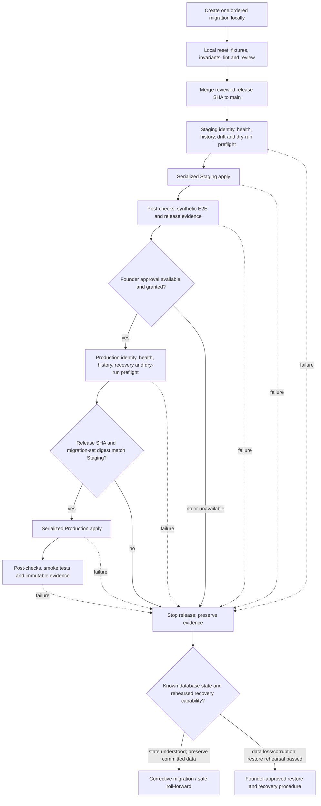

# R1 database migration and rollback process

- Status: Proposed for review
- Scope: Feature Inventory R1, Batch 1, Order 5
- Decision owner and sole initial operator: Founder
- Supported Supabase CLI: `3.0.0` exactly
- Syntax and Free-plan backup policy verified against official documentation: 2026-11-08
- Related architecture: [R1 production architecture and service boundaries](./r1-production-architecture.md)
- Related SLO: [R1 canonical redirect service-level objectives](./r1-redirect-slo.md)
- Related environments: [R1 environment strategy](./r1-environment-strategy.md)
- Related schema: [R1 production database schema and invariants](./r1-database-schema.md)

## Purpose and scope

This document defines the R1 process for creating, reviewing, validating,
applying, recovering from, and evidencing database migrations. It is a process
contract only. It does not create a Supabase project, migration file, GitHub
Actions workflow or Environment, secret, recovery point, database connection,
or hosted schema change.

The only promotion path is:

```text
Local → Staging → Founder approval → Production
```

Migrations are version-controlled Supabase CLI migrations. Hosted schema changes
through the Supabase Dashboard SQL Editor or Table Editor are prohibited. A
merge to `main` may start Staging migration and verification, but Production
uses the exact release SHA and migration set that passed Staging and waits for
the founder's GitHub Environment approval.

## Approved process decisions

| Decision | Operational consequence |
| --- | --- |
| Pin Supabase CLI `3.0.0` exactly. | Local and CI use the same reviewed command behavior. `latest`, semver ranges, beta, and next channels are prohibited. |
| Use Supabase CLI v3 target syntax. | Every hosted database command uses `--remote=<explicit-project-ref>` with the value attached by `=`. Bare `--remote` and implicit linked-project state are prohibited. |
| Keep one immutable migration history in Git. | An applied file is never edited, renamed, reordered, squashed, or deleted. A correction is a new migration. |
| Use separate GitHub Environments for Staging and Production. | Each environment owns distinct project identity, deploy credentials, secrets, approval/evidence, and concurrency group. |
| Use separate project-scoped Supabase PATs and database credentials. | Staging and Production each have a different scoped PAT restricted to that environment's single project and a different database credential/password. Legacy, shared, or account-wide tokens are prohibited. |
| Permit one-person Production self-approval. | The founder is the required reviewer and may approve a run they initiated. `Prevent self-review` must remain off. |
| Fail closed if the approval capability is unavailable. | If repository visibility or GitHub plan cannot enforce the required approval gate or protect Production secrets, Production deployment is blocked. |
| Serialize migrations per environment. | At most one migration deployment can be running per environment. Runs queue; an in-progress mutation is never canceled by a newer run. |
| Prefer expand/contract and safe roll-forward. | Code rollback is not database rollback. Restore is an explicit, evidence-based incident action. |
| Limit current R1 Production migrations to additive/expand changes. | With only Staging and Production and no Production data allowed in Staging, transforming, destructive, or irreversible Production migrations remain blocked until an approved isolated recovery capability passes a real restore rehearsal. |
| Retain durable sanitized release evidence. | A version-controlled migration release manifest is retained for the life of R1; expiring GitHub logs/artifacts are supporting evidence only. Sensitive backup/incident evidence stays in private operations storage for at least one year. |
| Use attended Production release windows. | The founder is present from final preflight through post-verification and ready to handle an incident immediately; unattended Production migration is prohibited. |

## Official tool contract

The process is based on these current primary references:

- [Supabase CLI v3 breaking-change notice](https://supabase.com/changelog/supabase-cli-v3)
- [Supabase local and hosted project targeting](https://supabase.com/docs/guides/local-development/local-and-hosted-projects)
- [Supabase CLI v3 migration guide](https://supabase.com/docs/guides/local-development/cli/migrating-to-v3)
- [Supabase database migration guide](https://supabase.com/docs/guides/deployment/database-migrations)
- [Supabase local CLI workflow](https://supabase.com/docs/guides/local-development/cli-workflows)
- [Supabase Free-plan backup FAQ](https://supabase.com/kb/faqs/platform/free-plan-backups)
- [Supabase database backups](https://supabase.com/docs/guides/platform/backups)
- [Supabase CLI backup and restore](https://supabase.com/docs/guides/platform/migrating-within-supabase/backup-restore)
- [GitHub deployment environments](https://docs.github.com/en/actions/reference/workflows-and-actions/deployments-and-environments)
- [GitHub deployment reviews](https://docs.github.com/en/actions/how-tos/deploy/configure-and-manage-deployments/review-deployments)
- [GitHub Actions concurrency](https://docs.github.com/en/actions/how-tos/write-workflows/choose-when-workflows-run/control-workflow-concurrency)

Supabase CLI v3 makes Local the default for database commands, requires an
explicit remote target for hosted commands, and requires confirmation for hosted
mutation. CI therefore passes `--yes` only after all release gates pass. It never
pipes confirmation input.

### Version pin and upgrade review

The initial approved pin remains CLI `3.0.0` exactly. Before the first workflow
implementation, the founder must recheck the current stable security and patch
releases, published advisories, and the v3 compatibility guidance. That check
does not silently change the pin: any version change follows the review below.
The future workflow must install the approved exact version and pin the setup
action to a reviewed full commit SHA. The release evidence records the resolved
action SHA, CLI version, and `supabase --version` output.

An upgrade is a separate reviewed change:

1. Read the official changelog, migration guide, release notes, and security
   notices between the pinned and proposed versions.
2. Compare command help for every command listed in this document, targeting,
   confirmation, migration ledger, diff engine, and transaction behavior.
3. Re-run clean Local reset, upgrade-path tests, drift detection, failure/partial
   migration exercises, and deterministic fixtures.
4. Rehearse Staging with the proposed CLI and retain the complete evidence set.
5. Update this document and the exact pin in the same review; obtain founder
   approval before Production uses the new CLI.

No job auto-upgrades the CLI. A prerelease is never promoted by a moving tag.

## Process overview



Order 6 remains a hard Production promotion dependency because the environment
strategy requires a testable Staging entrypoint, API/Worker routes, CORS, and an
end-to-end Staging flow. Order 5 does not define those values.

## Migration creation, naming, and ordering

### Create locally

Use the pinned CLI from the repository root:

```sh
supabase --version
supabase migration new <verb_object>
```

The first command must report exactly `3.0.0`. The second creates an ordered
file under `supabase/migrations/`; this document does not create that directory
or any migration.

Migration descriptions use lower snake case and a specific imperative action,
for example `add_link_safety_state` or `index_latest_public_links`. Avoid generic
names such as `update_schema`, ticket-only names, environment names, and secrets.
The CLI-generated UTC timestamp is the ordering key, producing the conceptual
shape:

```text
supabase/migrations/<UTC timestamp>_<verb_object>.sql
```

One file has one coherent purpose. If generated output crosses a transaction
boundary and the CLI emits multiple ordered files, review and commit the entire
set in its generated order. Parallel branches rebase before merge and verify
the final timestamp order. A migration already applied anywhere is immutable.
If an unapplied file must change after review, it receives a new release SHA and
must repeat Local and Staging; if it was applied in any environment, correction
requires a new migration.

### Required migration review record

Every migration PR records:

- purpose, affected objects, author, release SHA, ordered filename, and checksum;
- preconditions and expected current schema/migration-ledger state;
- transaction boundary, lock/latency estimate, timeout strategy, and whether
  any statement can leave partial state;
- data volume/backfill behavior, idempotency key/checkpoint, and retry policy;
- application compatibility across expand, transition, and contract releases;
- Order 4 pre/post invariant queries and expected zero-violation results;
- public projection, RLS/policy, secret, and data-classification impact;
- backup/recovery impact, migration classification, fresh logical-backup
  requirement, restore-rehearsal status, and recovery procedure;
- corrective roll-forward plan and the narrow condition where restore is safer;
- Staging verification and bounded Production smoke checks.

Generated SQL is reviewed statement by statement. Destructive operations,
unbounded table rewrites, long locks, privilege/RLS changes, non-transactional
directives, and data transformations are called out explicitly. Generated
output is never trusted merely because the CLI produced it.

## Local validation and deterministic fixtures

Local has no hosted-environment or Production credentials. The normal validation
sequence is:

```sh
supabase --version
supabase start
supabase migration list
supabase db reset
supabase db lint
```

In Supabase CLI v3 these commands target the Local stack because no `--remote`
is present. `db reset` rebuilds the disposable Local database, reapplies every
migration in order, and loads the configured deterministic seed files.

Local validation must cover both:

1. **Clean build:** reset from an empty Local database, apply the full history,
   load deterministic fixtures, and run schema/invariant tests.
2. **Upgrade path:** construct the prior reviewed schema locally with synthetic,
   production-shaped volumes, apply only the pending set, and run the same
   checks. Production records or exports are never used.

Fixtures follow Order 3: fixed UUIDs, codes, states, timestamps, totals, safe
documentation destinations, explicit fixture version, and idempotent reset.
They cover active/approved/eligible/Public, active/pending, active/blocked,
disabled, deleted, unknown-code absence, destination ownership, Latest 100,
reports/moderation, zero and non-zero aggregates, and 30-day click retention.
Random activity, real destinations, personal data, Production copies, or live
notifications are prohibited.

Local evidence includes CLI version, reset output, ordered ledger, fixture
version, invariant results, lint/test results, migration-set digest, and elapsed
time. A failure prevents merge.

## Immutable release and migration-set identity

The release candidate is identified by all of:

- full Git commit SHA (`release_sha`);
- exact CLI version;
- ordered migration filenames from repository history;
- SHA-256 checksum of every migration file;
- one `migration_set_digest` calculated from the ordered filename/checksum list;
- configuration-schema version and deterministic fixture-set version;
- workflow run ID and environment.

Staging records this manifest before and after apply. Production checks out the
same full release SHA and recomputes the digest. A different SHA, filename,
order, checksum, CLI version, or digest blocks Production even if the SQL appears
equivalent. No artifact contains data, secrets, project credentials, or Staging
fixtures.

### Durable release manifest

For every Staging and Production attempt, a sanitized migration release manifest
is committed to version-controlled durable storage and retained for the entire
life of R1. The implementation may choose the repository path, but the record
must be reviewable independently of an expiring CI system and contain exactly
the operational evidence needed to reconstruct the decision:

- environment label;
- full release SHA;
- ordered migration filenames and SHA-256 checksums;
- migration-set digest;
- bounded validation/preflight/post-check results;
- UTC timestamp;
- operator; and
- workflow/run reference.

The manifest may link to private evidence but never contains a PAT, database
password, secret, raw connection string, sensitive project identifier,
Production row/data export, protected destination, or unredacted command output.
GitHub logs and artifacts with expiry are supporting evidence only and can never
be the sole release record.

Backup metadata and sensitive incident evidence are retained in access-controlled
private operations storage for at least one year. That store is outside the
public repository and records access, retention, checksum, UTC time, and deletion
or legal-hold status without copying secrets or Production data into Git.

## Explicit target identity and remote command rules

Each hosted job must agree on these independent signals before receiving write
authority:

1. GitHub Environment is exactly `staging` or `production`.
2. `OP4N_ENV` matches that GitHub Environment.
3. The environment-scoped `SUPABASE_PROJECT_REF` equals the reviewed expected
   project identity and is on that environment's allowlist.
4. The environment supplies its own project-scoped Supabase PAT and its own
   database credential/password; neither value exists in the other environment.
5. The remote project reports the expected environment marker, region, active
   state, and healthy database/backend status.
6. The release SHA, CLI version, migration-set digest, and current migration
   history match the expected evidence.

Missing, ambiguous, linked, defaulted, or conflicting identity aborts before a
mutation. Hostname, branch, project display name, and operator memory are not
proof of target.

All hosted command examples attach the explicit v3 target with `=`:

```sh
supabase migration list --remote="${SUPABASE_PROJECT_REF}"
supabase db diff --remote="${SUPABASE_PROJECT_REF}"
supabase db push --dry-run --remote="${SUPABASE_PROJECT_REF}"
supabase db push --remote="${SUPABASE_PROJECT_REF}" --yes
```

The first three are history/drift/dry-run evidence. The final command is allowed
only inside the serialized environment job after its gates pass. A bare
`--remote`, cached link, interactive picker, developer shell profile, and the
deprecated linked/project-ref/database-URL target flags are prohibited. Hosted
reset and hosted seed flags are prohibited for Production. Staging fixture
seeding is a separate environment-guarded step and is never bundled into the
Production push.

The job compares the resolved target to the expected project reference in memory
before accepting evidence. It masks credential variables and raw project
identifiers before invoking the CLI, sanitizes captured output, and persists only
the environment label and an approved opaque target fingerprint. Credentials,
database URLs, connection strings, and raw project identifiers are never echoed,
uploaded, or copied into the release manifest.

### Credential scope and negative preflight

Staging and Production use different Supabase scoped PATs. Each PAT is restricted
by the provider to its one environment project; a legacy PAT, account-wide PAT,
shared token, or token that can enumerate/mutate both projects is prohibited.
Each environment also has a different database credential/password scoped to
its own database. There is no credential fallback, inheritance, or shared shell
profile.

At issuance, rotation, and before a credential version is admitted to a release,
a protected credential-isolation preflight proves both positive and negative
authorization:

1. Staging PAT and database credential can perform the approved bounded
   preflight against Staging.
2. The same Staging credentials are denied when the verifier attempts the
   equivalent read-only authentication against Production.
3. Production PAT and database credential can perform the approved bounded
   preflight against Production.
4. The same Production credentials are denied against Staging.

The verifier handles one candidate credential at a time in a protected operations
context and does not inject either environment's credential into the other
environment migration job. Opposite targets are passed as protected opaque
handles. Evidence records only environment labels, credential-version references,
UTC time, allowed/denied outcome, and verifier/run reference. It never records a
PAT, password, connection string, raw project/database identifier, provider error
payload containing identifiers, or query result. Any unexpected success,
ambiguous denial, missing negative test, legacy/account-wide token, or stale
attestation blocks both credential activation and Production migration.

## Migration history and schema drift

Before every hosted mutation:

1. `migration list` must show the remote history as an exact prefix of the
   candidate ordered migration set with no remote-only, missing-middle,
   reordered, or duplicate timestamp.
2. The stored checksum manifest must match every already-applied file. The
   Supabase migration ledger tracks timestamps, so Git evidence supplies the
   immutable content check.
3. `db diff` compares the hosted application-owned `public` schema with the
   schema reconstructed from the version-controlled migration history using the
   pinned v3 default diff engine. Its output is supporting evidence, never the
   only drift proof.
4. The dry run must list exactly the pending migration filenames in the approved
   order and no seed, role, or other unreviewed payload.

### R1 database drift scope

R1 database drift covers application-owned objects in the `public` schema:

- tables and columns;
- primary, unique, check, exclusion, and foreign-key constraints;
- application indexes;
- RLS enablement and policies;
- database functions; and
- triggers.

It also covers the migration ledger in `supabase_migrations`, including ordered
timestamps and the repository checksum evidence for every applied file. R1 must
not create custom tables, functions, triggers, policies, or other custom objects
inside Supabase-managed `auth` or `storage` schemas.

Drift proof combines the migration-ledger comparison, file checksums, reviewed
catalog/information-schema inventory for every object type above, RLS/policy
checks, Order 4 invariants, and `db diff`. A clean diff without the independent
catalog, ledger, checksum, and invariant evidence is insufficient. Any tool
coverage gap is recorded and fails closed until a reviewed compensating check
exists.

Supabase project configuration, secrets, Edge Functions, storage objects, and
Cloudflare Worker configuration are outside database drift scope. Their own
deployment/configuration gates compare the reviewed configuration manifest,
environment identity, release SHA, secret-name inventory (never values), and
deployed artifact/version. A clean database check cannot approve those separate
boundaries.

No job automatically pulls remote changes into Git or repairs the migration
ledger. Drift indicates an out-of-process mutation or incomplete apply. Preserve
the evidence, stop the release, determine the authoritative state, and reconcile
through a reviewed new migration. Migration-history repair is an exceptional
founder-approved incident action only after independent proof that schema and
data already match the intended state; repair changes ledger metadata, not the
schema, and is never used to make a red check green.

Dashboard SQL/Table Editor changes on Staging or Production are prohibited even
for small fixes. If one occurs, both normal promotion and Production emergency
migration remain blocked until drift is understood and reconciled in Git.

## Staging preflight, apply, and verification

Merge to `main` may start the Staging job for that exact release SHA.

### Preflight

- Acquire the Staging migration concurrency group without canceling an in-flight
  run; re-check `main` SHA after waiting.
- Verify CLI version, GitHub Environment, `OP4N_ENV=staging`, Staging project
  reference/marker, Singapore region, and Staging-only deploy identity.
- Confirm the Supabase Free Staging project is active and database/backend health
  checks pass. A paused project must be resumed through the normal supported
  operator flow, then the entire preflight is rerun.
- Verify migration history/checksums, zero unexpected drift, ordered dry-run,
  deterministic fixture version, and no Production reference or credential.
- Run Order 4 pre-migration invariants and store only bounded pass/fail/count
  evidence; never log codes, destinations, HMAC material, report text, or secrets.

### Apply and post-check

Apply the pending set once, then immediately capture the ledger and rerun the
history, drift, and Order 4 invariants. Load/reset only the approved synthetic
Staging fixtures through their separate guarded path. Verify creation,
active/pending/blocked/disabled behavior, exact correct destination, `302`
with `no-store`, public origin-only projection, Latest 100, exact search,
report/moderation, click aggregate, RLS/service boundaries, and telemetry.

Staging failure stops the release. A Staging pause or failure is not a Production
SLO failure, but it invalidates promotion evidence. Production never consumes
Staging rows, backups, migration ledger, credentials, or fixtures.

## GitHub Actions job and secret boundaries

This document defines future job boundaries but creates no workflow.

| Job boundary | Trigger and authority | Secrets/permissions | Required result |
| --- | --- | --- | --- |
| Local validation | Pull request and candidate SHA; no GitHub Environment. | Repository read; no hosted project reference, access token, database password, Production secret, or deploy permission. | Pinned CLI, clean reset, deterministic fixtures, tests/lint, invariant checks, and manifest pass. |
| Staging migration | Merge to `main`; GitHub Environment `staging`; concurrency group dedicated to Staging with queued, non-canceling runs. | Staging-only project ref variable, Staging-only scoped PAT restricted to the Staging project, and a separate Staging database credential/password. No Production secret or target authority. | Credential positive/negative attestation, active/healthy preflight, exact history/drift/dry-run, apply, post-check, E2E verification, and immutable evidence. |
| Production migration | Explicit promotion of the Staging-verified release; GitHub Environment `production`; founder approval; dedicated Production concurrency group with queued, non-canceling runs. | Production-only project ref variable, Production-only scoped PAT restricted to the Production project, and a separate Production database credential/password, released only after approval. No Staging credential or fixture authority. | Credential positive/negative attestation, same SHA/digest, backup evidence, preflight, apply, post-check, smoke test, and durable release manifest. |

Workflow permissions default to none and grant only the repository/deployment
reads or writes demonstrated necessary by implementation. Migration jobs cannot
push commits, edit workflow files, read the other environment's secrets, or use
a shared fallback credential. Environment secrets become available only to the
job that references that environment and only after its protection rules pass.

Supabase scoped PATs and database credentials must be distinct and restricted to
their one project. If the provider cannot enforce that restriction or the
negative preflight cannot prove it, the credential design fails Order 3
isolation and Production remains blocked until an approved least-privilege
method exists.

## Concurrency, retry, and idempotency

- Use a separate stable concurrency group for each environment. Configure queue
  behavior and `cancel-in-progress: false`; never cancel a running migration.
- After a queued job acquires the group, repeat identity, SHA, history, drift,
  health, and dry-run checks because state may have changed while waiting.
- Read-only health/history checks may retry with bounded exponential backoff and
  jitter. Each attempt records outcome without secrets.
- Do not automatically retry a hosted mutation after the CLI begins applying
  SQL. First classify transaction/ledger/schema state and follow the failure
  process below.
- The migration ledger makes a fully applied migration skip on later pushes,
  but it is not proof that a partially applied non-transactional file is safe to
  retry.
- Data backfills are bounded, resumable, and idempotent by stable primary key or
  explicit checkpoint. They never allocate replacement canonical codes.
- Precondition checks fail rather than silently treating an unexpected existing
  object or row state as success. `IF EXISTS`/`IF NOT EXISTS` cannot hide drift.

## Order 4 invariant gates

Pre- and post-migration checks use reviewed read-only queries and report bounded
counts/digests, never protected row values. Both environments require:

| Invariant | Required evidence and failure behavior |
| --- | --- |
| Issued-code uniqueness and non-reuse | Zero duplicate canonical codes; every existing code-to-link assignment and retired tombstone remains present and unchanged; issued-code count cannot decrease. Any violation blocks/halts release. |
| Destination ownership/correctness | Every current destination satisfies the composite `(link_id, destination_id)` ownership constraint and version 1 rules; existing link/destination mapping digest is unchanged unless the reviewed migration explicitly preserves the same normalized destination during HMAC rotation. A mismatch is a critical incorrect-destination incident. |
| Valid state axes | Lifecycle, safety, and discovery values and guarded timestamps are valid; `active + pending/blocked` may persist but cannot enter redirect or discovery projections; lifecycle restore never bypasses safety. |
| Public projection | Exact allowed columns only; rows require active + approved + public + eligible; summary is normalized origin only with policy version and contains no user info, path, query, fragment, report, moderation, or protected field. |
| Click aggregates and retention | Every total is non-negative and no existing total decreases; event/aggregate confirmation remains consistent; retention removes only confirmed events older than 30 days. |
| Referential integrity and RLS | Required UUID keys, unique/composite constraints, restricted deletion, deny-by-default base tables, and service capabilities remain effective. |
| Audit/moderation history | Append-only records and action/link ownership remain intact; no migration truncates or rewrites evidence. |

The pre-check captures a protected baseline digest for immutable mappings and
aggregates. The post-check compares it without exporting source values. A check
that is unavailable, times out, or produces ambiguous evidence fails closed.

## Backup and recovery impact assessment

Supabase Free has no automatic daily backup that this process can rely on. Before
every Production migration, including an additive migration, the attended
release creates a fresh encrypted logical backup with four separately identified
components:

1. roles;
2. schema;
3. data; and
4. migration-history schema and data.

The backup uses the explicit Production target and Production-only database
credential without printing either. It is written outside the public repository
to private off-site operations storage. Each component and the complete set have
a checksum and UTC timestamp. Backup metadata records the release SHA, encrypted
object references, tool version, bounded success result, checksum, creator, and
retention without storing a credential, raw connection string, sensitive project
identifier, or database content in Git or CI evidence.

A backup is only **created and integrity-checked** after export/checksum success.
It must not be called **verified restorable** until an actual restore into an
approved isolated recovery environment has completed and the restored roles,
schema, data, migration history, and Order 4 invariants have passed. File
existence, checksum verification, or a provider feature alone is not a restore
rehearsal.

Under the current two-project topology, Staging contains synthetic data and
Production data cannot be copied into Staging. There is no approved isolated
recovery environment. R1 therefore permits only additive/expand Production
migrations that preserve old readers/writers and can be corrected safely
forward. Transforming/backfill, destructive, contract, data-loss-risk, or
irreversible Production migrations are blocked even when a logical backup was
created. They remain blocked until an isolated recovery environment or equivalent
recovery capability is separately approved, can hold Production recovery data
under Production controls, and passes a real restore rehearsal for the proposed
procedure.

| Class | Examples of impact | Current Production rule |
| --- | --- | --- |
| Additive/expand | New nullable object, compatible constraint/index/policy, or dual-compatible structure without rewriting existing data. | Allowed only after the fresh four-part encrypted logical backup, normal gates, compatibility proof, invariant checks, and safe roll-forward plan. |
| Transforming/backfill | Data rewrite, HMAC rotation, populated-column conversion, constraint validation over changed data, or operation that mutates existing rows. | Blocked until approved isolated recovery capability and successful restore rehearsal exist. |
| Destructive/contract/irreversible | Drop/truncate, narrowing conversion, irreversible rewrite, tombstone/audit removal, or loss of backward compatibility. | Blocked until approved isolated recovery capability and successful restore rehearsal exist; a code rollback or unchecked backup cannot satisfy the gate. |

The assessment also records data volume, lock/downtime estimate, compatibility,
expected data-loss window, correction path, and incident response. This Order
does not authorize a third project, isolated recovery environment, paid-plan
change, backup workflow, or restore operation.

Backup files, metadata, and restored data remain in the Production/private
operations security scope. They are never copied to Local or Staging, committed
to Git, included in a migration artifact, or attached to an expiring public log.

## Expand/contract release sequence

Only step 1 is currently eligible for Production. Steps 2 and 5 transform or
remove existing data/schema and remain design guidance for a future approved
recovery capability; they are not authorized under the current R1 topology.

1. **Expand:** add compatible nullable structures, indexes, policies, or dual
   read/write capability without removing old behavior.
2. **Migrate/backfill (currently blocked in Production):** run a bounded,
   restartable transformation outside the
   redirect-critical response path; verify checkpoints and Order 4 invariants.
3. **Switch:** deploy code that prefers the new structure while remaining
   compatible with the old structure and last known-good application artifact.
4. **Observe:** complete Staging and Production verification, SLO observation,
   and a defined compatibility window.
5. **Contract (currently blocked in Production):** remove old structure only in
   a later separately reviewed
   migration with fresh recovery assessment and evidence that no live reader,
   writer, rollback artifact, or job depends on it.

No single release combines an irreversible contract with the first application
version that requires the expansion.

## Failure and partial-migration handling

On any failure, stop the release, retain the concurrency lock if safe, prevent
dependent code deployment, capture redacted output/ledger/target/SHA/digest, and
classify the database before retrying.

| Observed state | Required action |
| --- | --- |
| Candidate Production migration is not additive/expand | Block before mutation. Do not treat a backup as sufficient. Obtain separately approved isolated recovery capability and pass an actual restore rehearsal before reconsidering the migration. |
| Failure before mutation | Correct the cause, repeat full preflight, and retry only the same reviewed artifact if SHA/digest and target remain unchanged. |
| Transactional migration rolled back completely and absent from ledger everywhere | The file may be corrected only in a new commit/release SHA because it was not applied. Repeat Local and Staging. If applied anywhere, never edit it; add a corrective migration. |
| Migration applied and ledger updated, but post-check fails | Do not rerun or edit it. Freeze dependent release and preserve state. Prefer a reviewed corrective roll-forward; restore is available only when the recovery capability has passed an actual rehearsal. |
| Non-transactional or ambiguous partial apply | Do not blind-retry. Inspect actual objects/data and ledger read-only, compare with migration statements, and open an incident. Design a state-aware corrective migration; restore remains unavailable without an approved, successfully rehearsed capability. |
| History drift or checksum mismatch | Stop. Do not auto-pull or auto-repair. Reconcile actual state to Git with founder-approved evidence and a new migration. |
| Issued-code, destination-ownership, or incorrect-destination violation | Critical incident: stop all database/redirect releases, prevent further unsafe writes, contain affected redirects safely, preserve protected evidence, and choose correction/restore only after blast-radius checks. |
| Production project or approval gate unavailable | No Production migration. Keep current schema and use non-database containment that does not broaden authority. |

The same command returning non-zero does not reveal whether mutation occurred.
The operator must prove the state from ledger, schema, data invariants, and logs.

## Rollback and safe roll-forward decision tree

1. **Can compatible application rollback alone contain impact?** If yes, redeploy
   the last artifact that is compatible with the current database, then verify
   redirects and invariants. Do not claim the database was rolled back.
2. **Was no database mutation committed?** If yes, fix the cause in a new release
   SHA and repeat Local → Staging → approval → Production.
3. **Is the committed state understood and data intact?** Prefer a new corrective
   migration that preserves codes, destinations, aggregates, audit history, and
   forward compatibility. Rehearse it in Local and Staging first.
4. **Would roll-forward increase corruption or data loss?** Stop writes or use
   the smallest safe containment. Restore only when an approved isolated
   recovery capability and procedure have passed an actual rehearsal, the
   founder approves the expected data-loss window, and restore is safer than
   correction. A created/checksummed backup alone does not satisfy this gate.
5. **After correction or restore:** reconcile migration history without hiding
   drift, rerun all Order 4 invariants and redirect checks, record the incident,
   and require founder approval before releases resume.

An application/Worker rollback never deletes migration history, reverses schema,
restores rows, or makes old code allocatable. Database rollback is never inferred
from a green code-deployment status.

## Founder approval and Production release

The Production GitHub Environment names the founder as required reviewer. For
the one-person R1 operation, self-approval is intentional and `Prevent
self-review` remains disabled. Approval releases Production secrets only after
the founder reviews:

- Staging run and invariant results;
- exact release SHA, CLI version, ordered files/checksums, and migration digest;
- Production target identity through an approved opaque fingerprint and current
  history/drift/dry-run results;
- credential-isolation attestation for both directions;
- additive/expand classification, four-part encrypted logical-backup checksums,
  UTC timestamp, private off-site object references, and restore-rehearsal
  status;
- compatibility, lock/downtime, retry, corrective migration, and restore plan;
- current redirect SLO/release-freeze status and open incidents;
- one-at-a-time concurrency state and planned Production verification.

Every Production migration runs in an attended release window. The founder is
present from final preflight through post-verification, watches the bounded
health and invariant results, and is ready to contain or declare an incident
immediately. Unattended, scheduled-without-operator, or best-effort Production
migration is prohibited.

The job revalidates all mutable facts after approval and immediately before
mutation. Approval for one run, SHA, digest, and target cannot be reused.

GitHub's current feature availability varies by repository visibility and plan.
If required reviewer/self-approval behavior, Production Environment secrets, or
protection rules are unavailable or ignored, the Production job must not fall
back to an unprotected job, repository secret, manual CLI, or Dashboard SQL.
Production remains blocked until the repository/plan supports the approved gate
or a separately approved equivalent control is designed.

## Production apply and verification

Production repeats active/healthy, explicit identity, history, drift, recovery,
dry-run, invariant, SHA/digest, approval, and concurrency checks. It does not
seed fixtures or copy any Staging data. It applies exactly the pending set that
passed Staging.

After apply, retain the ledger and run:

- all Order 4 post-migration invariant checks;
- bounded active/unknown/disabled/pending/blocked redirect checks without
  following destinations, verifying exact `302`/`Location` and `no-store`;
- public projection/Latest/exact-search checks for origin-only safe output;
- report/moderation and aggregate checks that do not expose sensitive data;
- RLS/service-capability and telemetry checks;
- latency/error/saturation observation appropriate to the Order 2 release gate.

Failure stops dependent deployment and enters the decision tree. A completed CLI
command is not success until post-checks pass.

## Emergency migration process

Emergency changes use the same version-controlled path; urgency shortens elapsed
review time, not safeguards:

1. Open an incident and record impact, target, operator, containment, and why a
   database change is necessary.
2. Create a narrowly scoped migration and release SHA; do not use Dashboard SQL,
   Table Editor, an interactive linked project, or an unversioned command.
3. Complete pinned-CLI Local reset, preconditions, Order 4 invariants, failure
   analysis, additive/expand classification, and recovery assessment. An
   emergency does not authorize a transforming, destructive, contract, or
   irreversible Production migration under the current topology.
4. Apply and verify in Staging with the exact migration set. If Staging is paused,
   resume it and rerun preflight; do not skip it.
5. Create and integrity-check the fresh encrypted roles, schema, data, and
   migration-history backups in private off-site storage. Obtain founder
   Production Environment approval, confirm the opaque target fingerprint, and
   run the serialized Production job in an attended release window.
6. Verify, monitor, preserve evidence, and complete a post-incident review plus
   any permanent corrective migration.

If GitHub approval, Staging, target identity, required backup, attended operator,
or invariant checks are unavailable, the emergency migration is blocked. Use
the smallest safe non-database containment; an emergency does not expand
authority. Restore is not an emergency shortcut and remains unavailable until
its isolated capability has passed an actual restore rehearsal.

## One-person operator evidence checklist

The release record must let the founder stop and resume without relying on
memory. Store no secrets or protected row values.

- [ ] Order 5 process version and pinned CLI `3.0.0` recorded.
- [ ] Before first implementation, current stable security/patch releases were
      reviewed; any pin change passed compatibility review and Staging validation.
- [ ] Full release SHA, workflow run, environment, operator, and UTC times recorded.
- [ ] Ordered filenames, per-file SHA-256, and migration-set digest match review.
- [ ] Local clean reset, upgrade path, fixtures, lint/tests, and invariants passed.
- [ ] Environment marker, region, active/healthy state, and approved opaque target
      fingerprint match; raw project identity was not persisted.
- [ ] Separate scoped PAT and database-credential versions passed positive checks
      and both cross-environment negative checks without sensitive log output.
- [ ] Remote ledger is the expected prefix; checksums and application-owned
      `public` objects match combined drift evidence.
- [ ] Dry-run lists only the reviewed pending migrations and no seed/unreviewed payload.
- [ ] Staging apply, post-checks, synthetic E2E, and failure-handling exercise passed.
- [ ] Order 6 Staging E2E dependency passed before Production promotion.
- [ ] Production migration is additive/expand; all other classes remain blocked.
- [ ] Fresh encrypted roles, schema, data, and migration-history backups have
      private off-site references, checksums, and UTC timestamps; they are not
      labeled verified restorable without a successful actual rehearsal.
- [ ] GitHub Production gate is supported; founder approval is bound to this SHA/digest/target.
- [ ] Attended Production window is active; founder is ready to receive an
      incident; concurrency and preflight were rechecked after waiting/approval.
- [ ] Production apply ledger and all Order 4 post-checks passed.
- [ ] Bounded redirect/public/API/telemetry smoke checks passed without exposing protected data.
- [ ] Sanitized version-controlled release manifest contains every required field
      and no secret, raw connection string, sensitive project identifier, or data.
- [ ] Sensitive backup/incident evidence is in private operations storage with
      at least one-year retention; expiring CI evidence is not the sole copy.
- [ ] Corrective/restore decision, incident reference, and follow-up are recorded if applicable.
- [ ] Status remains Review until the user approves; no later Feature Inventory order was started.

## Principal PO/Architect decisions resolved

This review establishes the following R1 operating rules:

1. CLI `3.0.0` is the initial exact pin, with a security/patch recheck before
   first implementation and no moving tag or automatic upgrade.
2. Each environment uses its own one-project scoped PAT and database credential;
   reciprocal negative authorization tests are mandatory.
3. Free-plan automatic backup is not a recovery dependency. Every Production
   migration creates the four-part encrypted logical backup, while current
   Production mutation remains additive/expand only.
4. Drift covers application-owned `public` objects and the migration ledger;
   project configuration, secrets, Edge Functions, and Worker configuration use
   their own deployment/configuration gates.
5. Sanitized release manifests remain version controlled for the life of R1;
   sensitive backup and incident evidence remains private for at least one year.
6. Production migrations require an attended founder-operated window and remain
   blocked when the designed GitHub approval/protection gate is unavailable.

Implementation must still prove the provider-enforced credential scope, current
CLI compatibility, GitHub gate capability, concrete drift queries, backup export
mechanism, private storage controls, and evidence-manifest path in Local and
Staging before Production. This document does not authorize creating a workflow,
migration, secret, project, environment, recovery point, database connection,
or infrastructure change.

## Acceptance-criteria traceability

| Acceptance criterion | Evidence in this document |
| --- | --- |
| Migration creation, naming, review, ordering, immutability, and Local reset/test are defined. | Migration creation/review and Local validation sections. |
| Drift, history, Staging preflight, explicit target, release SHA, and migration set are verified. | Immutable identity, explicit target, bounded `public`-schema/ledger drift scope, combined evidence, and Staging sections. |
| Local, Staging, and Production jobs have separate authority, secrets, approval, and concurrency. | Separate one-project scoped PATs/database credentials, reciprocal negative preflight, GitHub Actions boundaries, concurrency, and founder approval. |
| Order 4 invariants run before and after every deployment. | Invariant-gates table and environment apply/verification steps. |
| Backup/recovery impact and destructive-change blocking are explicit. | Four-part encrypted logical backup policy, strict verified-restorable terminology, additive/expand-only Production rule, and recovery classification. |
| Rollback, corrective migration, partial failure, retry, and emergency behavior are actionable. | Failure table, decision tree, retry/idempotency, and emergency process. |
| Applied migrations cannot be edited and correction uses a new migration. | Approved decisions, ordering rules, history/drift controls, and failure handling. |
| Production cannot be targeted implicitly or reached by Local/Staging authority. | Explicit v3 `--remote=<project-ref>` commands, target guards, separate identities, and no credential fallback. |
| Codes cannot be deleted/reassigned and links cannot reach an incorrect destination. | Issued-code/destination invariant gates and critical failure handling. |
| Same Staging-verified artifact reaches Production only after founder approval. | SHA/digest match, GitHub Environment gate, Production preflight, and evidence checklist. |
| Production evidence survives expiring CI retention without exposing sensitive data. | Durable sanitized manifest and private one-year backup/incident evidence policy. |
| Production is attended and fails closed when approval protection is unavailable. | Attended release-window rule, GitHub capability gate, emergency rules, and operator checklist. |
| No live workflow, migration, schema, secret, database, or infrastructure is changed. | Purpose/scope and implementation boundaries throughout. |
