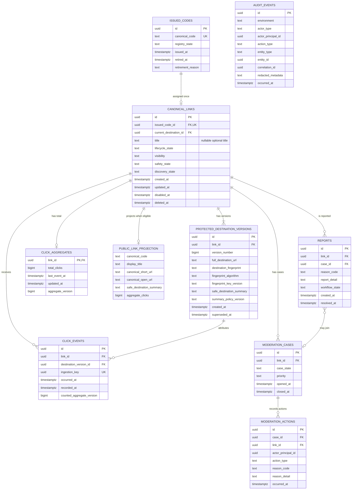

# R1 production database schema and invariants

- Status: Proposed for review
- Scope: Feature Inventory R1, Batch 1, Order 4
- Related architecture: [R1 production architecture and service boundaries](./r1-production-architecture.md)
- Related SLO: [R1 canonical redirect service-level objectives](./r1-redirect-slo.md)
- Related environments: [R1 environment strategy](./r1-environment-strategy.md)
- Related API contract: [R1 API contract and shared error model](../api/r1-api-contract.md)

## Purpose and scope

This document defines the logical Supabase Postgres schema for the R1 Guest
experience. It is a design contract, not an applied migration. It does not
create a database, Supabase project, role, policy, API route, credential, R2
ownership feature, or R3 custom alias.

The design gives the redirect path one authoritative mapping from a permanently
issued canonical code to one current protected destination version. Public
discovery uses a narrower projection and cannot read that protected destination.
Guest-created R1 links are Public and read-only.

All timestamps below are UTC `timestamptz`. All internal identifiers are UUIDs.
Canonical codes are public identifiers, not authorization credentials.

## Entity relationship diagram

`PUBLIC_LINK_PROJECTION` is a logical read projection, not a client-writable
table. `AUDIT_EVENTS` uses a typed entity reference rather than a foreign key to
every audited table, so it is shown separately from the relational lines.

## Data classification

| Class | Meaning | R1 examples | Handling boundary |
| --- | --- | --- | --- |
| Public | Deliberately returned by public discovery after eligibility checks. | Canonical code, display title/fallback, canonical short/Open URLs, approved safe destination summary, aggregate clicks. | May leave the backend only through the public projection. Output-encode and rate-limit. |
| Protected | Required by a narrowly scoped backend function but never part of public discovery. | Full destination URL, query parameters, fragment, destination fingerprint, lifecycle and safety state, internal UUIDs. | Backend services only. Redirect receives the minimum full destination for one eligible code. |
| Sensitive | Could reveal abuse reports, moderation reasoning, or an administrator. | Report detail, moderation reason detail, actor principal, non-public safety signals. | Founder/Admin workflows only; redact from general logs and audit metadata. |
| Operational | Supports reliability, traceability, and maintenance. | UTC timestamps, environment, correlation ID, aggregate and policy versions, workflow status. | Least-privilege operational access and retention; never treat it as automatically Public. |

Classification is field-specific. A row containing any Protected or Sensitive
field is not made public merely because another field in the row is Public.

## Schema dictionary

### `issued_codes` — permanent registry and tombstones

| Field | Class | Rules |
| --- | --- | --- |
| `id` | Operational | UUID primary key. |
| `canonical_code` | Public | Random, non-sequential canonical representation; unique and immutable. Order 6 defines the public API profile as case-sensitive ASCII alphanumeric, 6–32 characters, with exact normalization rules. |
| `registry_state` | Operational | `issued` or `retired`; never returns to an allocatable state. |
| `issued_at` | Operational | Set once when the code/link creation transaction commits. |
| `retired_at` | Operational | Nullable; set when the canonical link is permanently retired. |
| `retirement_reason` | Protected | Bounded reason code; no secret or free-form destination data. |

There is no delete path for this relation. A uniqueness conflict causes the
creation service to generate another random candidate. A collision does not
overwrite, reassign, or resurrect the existing row.

### `canonical_links` — authoritative link lifecycle

| Field | Class | Rules |
| --- | --- | --- |
| `id` | Protected | UUID primary key. |
| `issued_code_id` | Protected | Required unique foreign key to `issued_codes.id`; immutable after commit. |
| `current_destination_id` | Protected | Required at commit and points to a destination version owned by this same link. Immutable in R1. |
| `title` | Public when projected | Nullable, sanitized, bounded display title. Title is optional; fallback presentation belongs to the Order 6 API contract. It is not returned unless the row is discovery-eligible. |
| `lifecycle_state` | Protected | `active`, `disabled`, or `deleted`. Only `active` can redirect. |
| `visibility` | Protected | `public` or `unlisted`. R1 Guest creation writes only `public`; no R1 endpoint changes it. Visibility affects discovery, not a valid active redirect. |
| `safety_state` | Sensitive | `pending`, `approved`, or `blocked`. Only `approved` can redirect or be discovered. |
| `discovery_state` | Protected | `eligible` or `withheld`; must be `eligible` for Latest or exact public search. |
| `created_at`, `updated_at` | Operational | UTC audit timestamps. `created_at` is immutable; `updated_at` changes with state. |
| `disabled_at`, `deleted_at` | Operational | Required exactly when the corresponding lifecycle state applies. |

The R1 row has no owner or account foreign key. A Guest cannot update, delete,
disable, restore, or claim it through a public API.

### `protected_destination_versions` — immutable redirect targets

| Field | Class | Rules |
| --- | --- | --- |
| `id` | Protected | UUID primary key. |
| `link_id` | Protected | Foreign key to `canonical_links.id`; delete is restricted. |
| `version_number` | Operational | Positive monotonic value with composite uniqueness on `(link_id, version_number)`. It is not globally unique. R1 creates version 1 only. |
| `full_destination_url` | Protected | Validated absolute HTTP/HTTPS URL, including any query and fragment. Never selected into a public projection, report response, or discovery log. |
| `destination_fingerprint` | Protected | Versioned keyed HMAC of the normalized full destination, used for integrity/correctness checks. It is never a public identifier or response field. A plain or unsalted digest is insufficient. |
| `fingerprint_algorithm` | Protected | Required bounded algorithm identifier for the keyed HMAC. Algorithm changes create a new fingerprint version; they never reinterpret an old value. |
| `fingerprint_key_version` | Protected | Required opaque key-version identifier that supports backend key rotation without storing the key itself. |
| `safe_destination_summary` | Public when projected | Stores versioned policy output for a normalized origin and optional approved/redacted path. If no path is provably safe, it falls back to origin-only. Percent-encoded separators, user info, controls, ambiguous encoding, suspected sensitive tokens, query, fragment, and unapproved path content are prohibited. The API reconstructs `displayValue` from validated components and never emits this field as an unvalidated raw display string. |
| `summary_policy_version` | Operational | Required bounded identifier for the server-side policy that generated the summary and determined whether a path was safe to include. |
| `created_at`, `superseded_at` | Operational | Version-history timestamps. Routing identity fields remain immutable; only an audited post-deletion retention redaction may erase the protected URL. |

Both `(link_id, version_number)` and `(link_id, id)` are unique. The latter is
the composite ownership key: the current-destination reference is constrained
against it so a link cannot point to another link's destination. Creation
inserts the link, its immutable version 1 destination, and the current pointer
in one transaction with commit-time constraint checking. No partially wired
link becomes visible.

Concretely, the logical `(link_id, destination_id)` ownership constraint is the
composite foreign key `(canonical_links.id, current_destination_id)` referencing
`protected_destination_versions(link_id, id)`. Exact DDL remains implementation
work.

The HMAC key exists only in the relevant backend secret scope. It must not be
stored in Postgres, the repository, frontend configuration, application logs,
or audit metadata. Rotation changes the key version and re-HMACs through a
reviewed implementation path without exposing the full destination publicly.

### `public_link_projection` — public read contract

The public projection supplies exactly the values needed for the Order 6
`PublicLinkCard` response:

| Value | Source and rule |
| --- | --- |
| `canonical_code` | Immutable public canonical code; never authorization. |
| `display_title` | Sanitized `canonical_links.title` or the server-selected safe fallback when Title is null. |
| `canonical_short_url` | Constructed by the backend from approved `op4n.me` configuration and the canonical code; the database does not guess an API or host route. |
| `canonical_open_url` | Same environment canonical redirect entrypoint used by the browser Open action; never a protected destination. |
| `safe_destination_summary` | Normalized origin plus only a policy-approved/redacted path, or origin-only fallback. User info, query, and fragment are excluded. |
| `aggregate_clicks` | Non-negative `click_aggregates.total_clicks`, defaulting to zero when no aggregate row exists. |

The service-only read model may use the canonical code as its exact filter, but
the serialized public object exposes no internal UUID, full destination,
destination fingerprint, lifecycle/safety fields, report, moderation data,
query parameter, or fragment. Projection eligibility requires all of:

- `lifecycle_state = active`;
- `visibility = public`;
- `safety_state = approved`;
- `discovery_state = eligible`; and
- a valid current destination owned by the link.

### `click_events` and `click_aggregates`

| Record/field | Class | Rules |
| --- | --- | --- |
| `click_events.id` | Operational | UUID primary key. |
| `link_id`, `destination_version_id` | Protected | Foreign keys identify the mapping snapshot that emitted the successful `302`. They are never public. |
| `ingestion_key` | Operational | Worker-supplied UUID event identity unique throughout the rolling 30-day event retention and independent of generic idempotency-record expiry; it is not derived from a person or device. |
| `occurred_at`, `recorded_at` | Operational | `occurred_at` is accepted only within a bounded clock-skew window. Server-generated `recorded_at` is authoritative for the rolling retention scan and deletion. |
| `counted_aggregate_version` | Operational | Required aggregate version produced by the same transaction that increments `total_clicks`; proves the stored event was counted before retention can remove it. |
| `click_aggregates.link_id` | Protected | One aggregate row per canonical link. |
| `total_clicks` | Public when projected | Non-negative, monotonically increasing aggregate of accepted events. |
| `last_event_at`, `updated_at`, `aggregate_version` | Operational | Reconciliation and concurrency metadata. |

Individual click events use a rolling 30-day retention window. The restricted
retention job may delete only an event older than 30 days whose
`counted_aggregate_version` is confirmed in the link's current aggregate.
`click_aggregates.total_clicks` is cumulative and must not decrease when event
detail expires. Click events are immutable until that restricted deletion.
An identity already accepted and counted cannot increment the aggregate again
when a generic idempotency record expires. Environment is derived from the
authenticated internal service context rather than trusted from the event body.

R1 does not store raw IP addresses, user-agent strings, device identifiers,
fingerprints, edge/location fields, or precise locations. Click insertion and
the aggregate increment form one post-response analytics transaction. Failure
or delay must not block, replace, or slow the valid `302`; the whole analytics
write may be lost during an outage, as accepted by Order 1. Storage pressure
must not silently shorten the 30-day window: any retention change requires
review and an updated policy/versioned document.

### `reports`

| Field | Class | Rules |
| --- | --- | --- |
| `id` | Protected | UUID primary key. |
| `link_id` | Protected | Required foreign key; delete restricted. |
| `case_id` | Sensitive | Nullable foreign key when triage attaches the report to a moderation case; the case must reference the same link. |
| `reason_code` | Sensitive | Bounded public-submission category. |
| `report_detail` | Sensitive | Optional bounded free text, sanitized and visible only to Admin. No reporter IP/device is stored for product analytics. |
| `workflow_state` | Sensitive | `new`, `triaged`, or `resolved`; public callers cannot read it. |
| `created_at`, `resolved_at` | Operational | UTC workflow timestamps. |

A report insert cannot directly mutate redirect state. It may cause discovery to
be withheld only through an explicit policy workflow; disabling a redirect
requires an audited moderation action.

### `moderation_cases` and `moderation_actions`

| Record/field | Class | Rules |
| --- | --- | --- |
| `moderation_cases.id`, `link_id` | Sensitive | UUID primary key and restricted link foreign key. |
| `case_state`, `priority` | Sensitive | Bounded workflow values; not public safety signals. |
| `opened_at`, `closed_at` | Operational | UTC workflow timestamps. |
| `moderation_actions.id`, `case_id`, `link_id` | Sensitive | UUID primary key and restricted foreign keys. The action link must match the case link. |
| `actor_principal_id` | Sensitive | Opaque authenticated Admin principal identifier. R1 has one founder operator; this is not an R2 owner account. |
| `action_type` | Sensitive | Append-only `disable`, `restore`, `withhold_discovery`, `restore_discovery`, or `note`. |
| `reason_code`, `reason_detail` | Sensitive | Required bounded code for state changes; optional protected detail. |
| `occurred_at` | Operational | Immutable UTC action time. |

The moderation transaction appends the action and changes the authoritative
link state together. A partial action never disables or restores a link. Restore
is allowed only if the current safety and lifecycle rules permit it.

### `audit_events` — append-only operational history

| Field | Class | Rules |
| --- | --- | --- |
| `id` | Operational | UUID primary key. |
| `environment` | Operational | Required `staging` or `production`; Local audit fixtures remain local. |
| `actor_type`, `actor_principal_id` | Sensitive | `system` or `admin`; an Admin principal is required for founder actions. |
| `action_type`, `entity_type`, `entity_id` | Protected | Bounded event taxonomy and target UUID. |
| `correlation_id` | Operational | UUID for tracing one operation without embedding payload data. |
| `redacted_metadata` | Sensitive | Structured, size-bounded metadata allowlist. Never contains secrets, full destination URLs, query parameters, fragments, raw report text, IP, or device data. |
| `occurred_at` | Operational | Immutable UTC event time. |

Audit rows are append-only and cannot be edited by public, redirect, or report
paths. An audit failure makes an Admin mutation fail closed; it does not break an
already-valid redirect.

## Lifecycle, referential integrity, and deletion

### State and transition matrix

The three state axes are persisted independently. A combination can be valid to
store while still being ineligible for redirect or discovery. Every transition
is an atomic, audited backend operation; no public caller can write these axes.

| Axis | Persisted values | Initial successful Guest value | Allowed R1 transitions | Authorized writer and guard |
| --- | --- | --- | --- | --- |
| `lifecycle_state` | `active`, `disabled`, `deleted` | `active` | `active ↔ disabled`; `active/disabled → deleted`; `deleted` is terminal. | Founder/Admin moderation service. `disabled` is the moderation lifecycle state. Restore to `active` is rejected unless safety is already `approved`; it cannot bypass `pending` or `blocked`. |
| `safety_state` | `pending`, `approved`, `blocked` | `approved` | `pending → approved/blocked`; `approved → pending/blocked`; `blocked → pending` for a new review. Direct `blocked → approved` is not allowed without passing through reviewed `pending`. | Safety-screening backend records screening outcomes; authenticated founder/Admin may open a new review or record a policy decision. `blocked` is a safety decision, not a lifecycle state. |
| `discovery_state` | `eligible`, `withheld` | `eligible` | `eligible ↔ withheld`. | Safety/discovery policy backend or authenticated founder/Admin. `withheld` is a discovery decision and does not itself disable a redirect. |

R1 Guest visibility is written as `public` and is immutable after commit. It is
not an owner control. Screening completes before a successful creation commit,
so a newly created Guest link starts exactly as `active + approved + eligible +
public`. A failed or incomplete initial screen does not commit a successful
Guest link. Later rescreening can validly persist `active + pending` or `active +
blocked`; both remain non-redirecting and absent from discovery until safety is
approved again.

### State invariants

1. `active + pending` and `active + blocked` are valid persisted combinations.
   They do not redirect and do not appear in public discovery.
2. Redirect eligibility requires `lifecycle_state = active`, `safety_state =
   approved`, one issued code, and exactly one valid current destination owned
   by that link. Discovery and visibility states do not authorize the redirect.
3. Public discovery requires every redirect condition plus `visibility =
   public` and `discovery_state = eligible`.
4. `disabled` is a moderation lifecycle state, `blocked` is a safety decision,
   and `withheld` is a discovery decision. No axis silently rewrites another.
5. Restoring lifecycle from `disabled` to `active` is rejected while safety is
   `pending` or `blocked`. Safety must be independently approved first.
6. `disabled` requires `disabled_at`; `deleted` requires `deleted_at`. Neither
   state redirects or appears in discovery.
7. A retired code remains in `issued_codes` forever and cannot be returned to an
   allocator, even if every other retained record is later minimized.
8. Code-to-link assignment and destination identity, ownership, version, and
   normalized full destination are immutable after commit. An audited HMAC key
   rotation may replace only the fingerprint/algorithm/key-version metadata for
   that same normalized destination. A rotation or retention redaction cannot
   install a different destination.
9. A `deleted` link has a `retired` issued-code registry row. A disabled link's
   code remains issued but is never available for allocation.
10. Click events are immutable during their rolling 30-day window and can be
    deleted only by the restricted retention job after aggregate confirmation.
    Moderation actions and audit events remain append-only.
11. Aggregate clicks cannot be negative or decrease. Expiring click events does
    not reduce the aggregate.

### Foreign keys and deletion behavior

| Relationship | Behavior |
| --- | --- |
| Issued code → canonical link | One code is assigned to at most one link. Code and assignment are immutable; hard delete and reassignment are forbidden. |
| Canonical link → destination versions | Delete restricted. The composite ownership constraint prevents cross-link destinations. |
| Canonical link → click/report/moderation records | Core hard delete restricted. The restricted retention job may remove only aggregate-confirmed click events after the 30-day rolling window, never the aggregate or code tombstone. |
| Moderation case → action | Delete restricted; actions are append-only. |
| Any audited entity → audit event | Logical typed reference retained even if non-core detail is later minimized. |

Product deletion is a soft transition to `deleted`, not a row delete. A later
retention policy may irreversibly redact the protected full destination after
the link is deleted and its required retention period expires. That exceptional
operation is audited and cannot install a new target. It must preserve the
issued-code tombstone, canonical link
UUID/state, destination version identity/fingerprint, moderation history, and
enough audit evidence to prove non-reuse. Click-event retention is fixed at 30
days for R1; retention for other protected records remains a later policy
decision. Storage pressure cannot change retention without review.

## Service, role, and RLS boundaries

Browsers never receive the Supabase Secret key and do not select base tables
directly. RLS defaults to deny for public and client roles; narrowly scoped
backend operations expose only the capabilities below. Concrete API hostname,
routes, request schemas, public route mapping, and CORS are defined by the
linked Order 6 contract and remain undeployed.

| Principal/service | Allowed capability | Explicitly denied |
| --- | --- | --- |
| Static frontend with `SUPABASE_PUBLISHABLE_KEY` | No direct base-table access. Calls the environment-configured backend API under RLS. | Full destinations, base-table reads/writes, Admin data, Secret key. |
| Creation API | Complete validation and safety screening first; transactionally insert a unique issued code, an `active + approved + eligible + public` canonical link, destination version 1, zero aggregate, and audit event. Return only the creation response contract. | Commit a successful link while initial screening is pending/blocked, reassign/reuse codes, expose protected rows, or mutate existing Guest links. |
| Redirect service | Execute one exact, read-only redirect lookup that can return the full destination only for one eligible code. Append a minimized click event/aggregate after response through a separate capability. | Listing/scanning destinations, reading reports, moderation, or letting analytics gate the `302`. |
| Public listing/search service | Read the public projection for Latest 100 or one exact canonical code. | Full destination, query/fragment, internal UUIDs, reports, moderation and broad fuzzy search. |
| Report service | Insert a rate-limited report with bounded fields. | Read report status/data or change lifecycle/discovery state. |
| Admin moderation service | Authenticated founder-only case/report lookup and atomic audited state transitions. | Restore lifecycle while safety is pending/blocked, unscoped public access, code reassignment, audit rewriting, or secret exposure. |
| Migration operator | Apply reviewed forward migrations in the selected environment with an environment preflight and ledger. | Runtime access, cross-environment credentials, code reuse, destructive core-table cascades. |

`SUPABASE_SECRET_KEY` is a privileged backend secret. It must not appear in a
browser, frontend bundle, repository, logs, or an unrelated Local/Staging scope.
Even when a backend connection can bypass RLS, service code must keep the
capability boundaries above and emit redacted audit evidence.

## Query and index design

Every R1 index below has a named query path or enforces an approved invariant.
Primary-key indexes are implicit and omitted from this list. Concrete DDL,
predicate syntax, `EXPLAIN`/query-plan validation, load testing, and final index
selection belong to later migration/implementation work; this document does not
authorize creating them.

| Query path | Access pattern and supporting index | Result boundary |
| --- | --- | --- |
| Exact canonical redirect | Unique B-tree on `issued_codes(canonical_code)`; unique `canonical_links(issued_code_id)`; unique destination ownership key `(link_id, id)`. One atomic lookup checks code, `active + approved`, and destination ownership. | At most one full destination/version for the redirect service. |
| Destination creation/integrity | Unique `(link_id, version_number)` prevents duplicate versions within one link; `(link_id, id)` proves the current destination belongs to that link. | R1 commits version 1 only. Neither constraint implies global version-number uniqueness. |
| Latest 100 | Partial descending index on `canonical_links(created_at, id)` for `active + approved + public + eligible`; keyset pagination; join one aggregate and the policy-approved safe summary. | Exactly the six-field public card projection; limit 100. |
| Exact public search | Reuse the unique canonical-code lookup and apply the same public eligibility predicate. No additional search index and no destination, title, prefix, or fuzzy scan. | Zero or one six-field public card projection. |
| Click idempotency | Unique `click_events(ingestion_key)` rejects duplicate post-response writes. | Backend analytics only; public sees only the cumulative total. |
| Click retention | B-tree on `click_events(recorded_at, id)` scans events older than 30 days in stable batches; deletion additionally verifies `counted_aggregate_version`. | Restricted retention job only. There is no `(link_id, occurred_at, id)` index because R1 has no query requiring it. |
| Report queue and Admin case lookup | `reports(workflow_state, created_at, id)` serves the founder's pending queue; `reports(link_id, created_at, id)` serves reports for one exact link; `moderation_cases(link_id, opened_at, id)` finds its cases; `moderation_actions(case_id, occurred_at, id)` renders one case timeline. | Authenticated founder/Admin only. Exact link/code lookup reuses primary/unique keys. |

Latest and Admin lists use `(timestamp, UUID)` as a stable cursor. No audit,
location, broad-search, click-by-link timeline, or other speculative secondary
index is proposed for R1. A new index requires a measured query, reviewed query
plan, and Free-tier write/storage impact review.

## Redirect correctness and failure behavior

The redirect query is the only authority for code-to-destination resolution:

1. Normalize the request code according to the linked Order 6 contract and use
   the unique registry lookup; never use a prefix, case-insensitive fallback, or
   destination-derived search.
2. In one database statement/snapshot, join the immutable code assignment to
   its canonical link and that link's current destination version.
3. Require `active`, `approved`, and a matching destination ownership pair.
   Visibility does not block active Public or future Unlisted redirects.
   Persisted `active + pending` and `active + blocked` rows return no redirect;
   they are valid stored states, not integrity violations.
4. Return the destination UUID/version, full validated URL, and fingerprint as
   one immutable result. The Worker emits `302` and `Cache-Control: no-store`
   from that result; it does not perform a second lookup.
5. Record analytics only after the redirect decision and attribute the event to
   the same link and destination version.

An ambiguous result, ownership mismatch, invalid URL, missing destination,
unexpected multiple row, database error, or integrity-check failure fails
closed: emit no destination `Location`, count an availability failure where the
SLO applies, alert the founder, and investigate. The service must never guess,
fall back to another version/link, or use a discovery projection as redirect
authority. This is preferable to an incorrect-destination response, which is a
critical incident under the redirect SLO.

Analytics, Latest Links, exact public search, reports, dashboard, notifications,
and management UI have no synchronous write dependency in this lookup. Their
failure cannot change or block the valid `302` path.

## Migration, backup, and environment invariants

- Migration design is forward-only and expand/contract. Add nullable or
  backfillable structures, verify invariants, then tighten constraints; never
  rebuild the code registry by deriving new codes from link rows.
- Every code-affecting migration proves a one-to-zero-or-one assignment,
  uniqueness, and permanent tombstone preservation before promotion.
- Backups and restores must include `issued_codes` with canonical links. A
  restore into an environment cannot merge Production codes into Staging or
  make absent Production codes allocatable.
- Staging uses deterministic synthetic records and its own code namespace/data.
  Local and Staging cannot read or mutate Production, per the environment
  strategy.
- Production migration preflight confirms the Production Supabase project is
  active/healthy, the selected environment is `production`, and the reviewed
  migration ledger matches. No schema is applied by this Order 4 document.
- A schema rollback never deletes issued-code rows or rewinds code ownership.
  Application rollback must remain compatible with the expanded schema.
- A restricted rolling-retention job scans `(recorded_at, id)`, verifies each
  event's aggregate version was counted, and deletes only eligible events older
  than 30 days. It never decrements or rebuilds `total_clicks` from the retained
  window.

## Additive future evolution, not R1 implementation

- **R2 ownership:** add account/ownership relations keyed by canonical link UUID.
  Existing Guest links remain ownerless and unclaimable by code alone. Do not
  add an owner field, authentication behavior, edit API, or ownership policy in
  R1.
- **R3 aliases:** add a separate alias registry and alias-to-canonical-link
  relation with its own permanent history. An alias never replaces, mutates, or
  releases the canonical code. Do not add alias allocation or redirect behavior
  in R1.

Both extensions must preserve the canonical code registry, destination
ownership constraint, public projection boundary, and redirect correctness SLO.

## Approved review decisions, assumptions, and limits

- Supabase Postgres in Singapore is the R1 system of record; Staging and
  Production are separate Free projects. Free-tier capacity, pause behavior,
  and one-founder operation are accepted constraints.
- The three independent state axes, policy-approved public summary with
  origin-only fallback, immutable destination version 1, versioned keyed-HMAC
  fingerprint, rolling 30-day click retention, and query-backed index set are
  finalized Order 4 review decisions.
- Order 6 defines the canonical-code API profile, exact-input normalization,
  API schemas/routes, CORS, and rate-limit policy-class identities. Numeric
  rate limits, non-click retention durations, and concrete database policies/DDL
  remain later implementation work.
- This document proposes logical roles and constraints. Migration implementation
  must demonstrate that Supabase/RLS behavior and query plans match them before
  Production. Storage pressure or load evidence can trigger a reviewed change;
  it cannot silently alter retention or add speculative indexes.

## Acceptance criteria traceability

| Acceptance criterion | Evidence in this document |
| --- | --- |
| ERD and schema dictionary cover keys, constraints, relationships, lifecycle, deletion, audit, classification, RLS/service boundaries, and indexes. | ERD; Data classification; Schema dictionary; State/transition matrix; Lifecycle; Service boundaries; Query/index design. |
| Independent lifecycle, safety, and discovery axes have guarded transitions and the successful Guest initial state is explicit. | State and transition matrix; State invariants 1–6; Creation API boundary. |
| Canonical codes are random, unique, permanent, and never reused after deletion or migration. | `issued_codes`; State invariants 7–9; deletion and migration rules. |
| Public output contains only eligible safe fields and never a protected destination, unapproved path, user info, query, fragment, report, or moderation data. | Policy-approved/redacted `safe_destination_summary` with origin-only fallback; `public_link_projection`; classification and RLS boundaries. |
| Protected destination integrity uses immutable version 1, composite ownership/version constraints, and a rotatable versioned keyed HMAC. | Destination dictionary; HMAC secret boundary; State invariant 8. |
| Exact redirect, Latest 100, exact search, retention, and Admin lookup have non-speculative supporting paths. | Query and index design. |
| Incorrect-destination behavior is prevented and fails closed. | Destination ownership constraint and Redirect correctness/failure behavior. |
| Click data is minimized, retained for a rolling 30 days only after aggregate confirmation, and analytics failure does not block redirect. | Click dictionary; deletion/retention rules; redirect dependency boundary. |
| R2/R3 remain unimplemented while future evolution is additive. | Additive future evolution section. |
| No database or infrastructure is changed. | Scope statement and migration boundary. |
