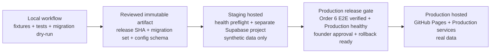

# R1 environment strategy

- Status: Proposed for review
- Scope: R1 Create as Guest, Feature Inventory Batch 1, Order 3
- Related architecture: [R1 production architecture and service boundaries](./r1-production-architecture.md)
- Related SLO: [R1 canonical redirect service-level objectives](./r1-redirect-slo.md)
- Related API contract: [R1 API contract and shared error model](../api/r1-api-contract.md)
- Decision owner and initial operator: Founder
- Last updated: 2026-11-08

## Purpose and decisions

This document defines environment separation for R1 as an internal design and
operating strategy. It does not create a Supabase project, deploy a Worker,
change DNS or GitHub Pages, choose an API hostname or route, configure CORS, or
write any secret.

R1 has exactly two hosted environments:

1. **Staging** — hosted verification using synthetic data only.
2. **Production** — the live public service and real production data.

**Local** is a developer workflow on a developer-controlled machine or
disposable local runtime. It is not a hosted environment. R1 does not add
Development, Preview, QA, or per-branch hosted environments.

Staging and Production use separate Supabase Free projects in Singapore so the
hosted verification topology matches the Order 1 Production region. GitHub Pages
remains the Production frontend for `op4n.com`. This decision does not create a
second GitHub Pages site or select a hosted Staging frontend. Order 6 now defines
the planned Staging entrypoint, API/Worker route contracts, and exact CORS
behavior, but does not create or deploy them.

The Supabase Free plan's two active-project capacity is fully allocated to
Staging and Production. R1 has no capacity for an additional Preview or QA
project without pausing an existing project or changing plan; neither action is
authorized here. Free projects may pause after inactivity. This strategy adds no
keep-alive workaround and does not change to a paid plan.

## Environment boundaries

| Boundary | Local workflow | Staging hosted environment | Production hosted environment |
| --- | --- | --- | --- |
| Purpose | Fast development, linting, unit/component tests, migration dry-runs, and deterministic fixtures | Integration, migration, fault, SLO instrumentation, synthetic end-to-end, and release-candidate verification | Live Guest R1 traffic, durable canonical links, redirects, reports, moderation, and operational monitoring |
| Frontend | Local files or local server at `http://127.0.0.1:5500`; never a hosted Local environment | Planned `https://staging.op4n.com`; Order 6 defines the contract but does not create hosting | Static `https://op4n.com` frontend on GitHub Pages |
| Backend | Mock adapters or disposable local services only | Dedicated Supabase Free Staging project and Staging-scoped backend configuration | Dedicated Supabase Free Production project and Production-scoped backend configuration |
| Data | Deterministic local fixtures; disposable | Deterministic synthetic fixtures only; resettable | Real production records; never copied to Local or Staging |
| Redirect surface | Local simulation or test harness | Planned `https://staging.op4n.me/{code}` synthetic redirect entrypoint; not created by Order 6 | Public `https://op4n.me/{code}` Cloudflare edge and Worker route defined by Order 1 |
| Users | Developers/test automation; no real user records | Synthetic actors only | Real public users and founder-operated Admin functions |
| Availability claims | None | Test evidence only; excluded from Production SLO calculations | Order 2 request and synthetic SLIs after its release gates pass |

“Local and Staging cannot read or modify Production data” means they receive no
Production database, Supabase Secret key, storage, analytics, Worker, or
third-party credentials and have no privileged Production data path. Public
Production responses remain visible to any internet visitor by product design;
that public Guest access is not privileged environment access and does not
weaken this isolation rule.

## Supabase Free-tier assumptions and operating constraints

- The two active Free-plan projects are the dedicated Staging and Production
  projects. Preview, QA, and other hosted project variants are unavailable
  without pausing one of those projects or reviewing a plan change.
- A Free project may pause after inactivity. Before any Staging migration, seed,
  integration test, or verification run, a preflight must confirm the Staging
  project is active and its required database/backend health checks pass. If it
  is paused or unhealthy, stop before mutation, restore it through the normal
  supported operator flow, and rerun preflight.
- A Staging pause is a Staging readiness failure and a gap in test evidence. It
  is not a Production SLO failure and is never inserted into Production Order 2
  request or synthetic denominators.
- The Production release gate must confirm the Production project is active and
  healthy before any Production migration, backend/Worker deployment, or
  post-deploy verification begins. A failed preflight blocks the release.
- Order 3 authorizes no keep-alive traffic, scheduled wake-up, paid-plan change,
  additional Supabase project, or other infrastructure workaround. Any such
  proposal requires separate cost, reliability, security, and rollback review.

## Isolation requirements

| Resource | Required separation |
| --- | --- |
| Database | Separate Supabase projects, Postgres databases, migration ledgers, database URLs, roles, policies, and connection credentials. Never restore, replicate, or export Production data into Staging or Local. |
| Credentials and secrets | Separate secret values and scopes for Staging and Production. A Supabase Publishable key is public-client configuration governed by RLS, not privileged authority. A Supabase Secret key is a backend-only privileged secret. Production secrets exist only in the Production deployment/operations scope; they are absent from developer machines, Local configuration, Staging, fixtures, logs, and repository files. |
| API configuration | Separate environment configuration and project references. Order 6 defines `API_BASE_URL` as the environment Supabase `op4n-api` function URL and resources beneath `/api/v1`; deployment substitutes and validates the protected project reference. |
| Worker configuration | Separate environment binding, variables, secrets, project reference, route configuration, analytics binding, and deployment record. Staging uses the planned `staging.op4n.me/{code}` contract and must never bind `op4n.me/{code}`. |
| Storage | Separate project storage and bucket identifiers. Staging accepts synthetic assets only. Production objects are never copied into Local or Staging for debugging or fixtures. |
| Analytics and logs | Separate datasets/sinks and write credentials. Every event carries the explicit environment identifier. If a provider cannot isolate non-production data, Staging uses a stub or keeps that export disabled rather than sharing the Production sink. Staging synthetic traffic never contributes to Production SLOs, click totals, dashboards, or alerts. |
| Third-party keys | Prefer distinct sandbox/Staging and Production keys. If a provider cannot issue isolated non-production credentials, keep that integration disabled or use a deterministic stub in Staging until the founder reviews the risk; never reuse a Production key by convenience. |
| Notifications | Staging uses a sink, stub, or explicit safe allowlist and must not contact real users or the public support workflow. Production uses its separately scoped delivery configuration. |
| Backups and exports | Staging backups contain synthetic data only. Production backups and exports stay in Production-controlled storage and access scope and are never used as Staging seeds. |

Code and migration artifacts may be identical across environments. Authority,
state, credentials, and configuration never move with the artifact.

## Configuration matrix

This matrix defines configuration names, ownership, and approved Order 6
placeholder/route shapes only. It contains no secret value or actual project
identifier and does not configure a hostname, route, or CORS rule.

| Configuration name | Local | Staging | Production | Secret? |
| --- | --- | --- | --- | --- |
| `OP4N_ENV` | Literal `local` | Literal `staging` | Literal `production` | No |
| `RELEASE_SHA` | Current working revision or test value | Deployed release revision | Deployed release revision | No |
| `CONFIG_VERSION` | Local/test manifest version | Staging manifest version | Production manifest version | No |
| `API_BASE_URL` | Mock/local adapter or explicitly approved Staging value | `https://<staging-project-ref>.supabase.co/functions/v1/op4n-api` placeholder shape | `https://<production-project-ref>.supabase.co/functions/v1/op4n-api` placeholder shape | No; project references remain environment-scoped and are validated at deployment |
| `SUPABASE_PROJECT_REF` | Absent or disposable local value | Staging project reference | Production project reference | Treat as configuration, not authority |
| `SUPABASE_URL` | Absent or disposable local value | Staging project value | Production project value | No; value still environment-scoped |
| `SUPABASE_PUBLISHABLE_KEY` | Absent or disposable local publishable value | Staging Publishable key for public clients under Staging RLS | Production Publishable key for public clients under Production RLS | Public but environment-scoped; not privileged authority |
| `SUPABASE_SECRET_KEY` | Absent | Staging backend-only privileged secret | Production backend-only privileged secret | Yes; privileged |
| `FOUNDER_AUTH_ISSUER` | Absent/local test value | Expected Staging Supabase Auth issuer | Expected Production Supabase Auth issuer | No; exact environment-scoped value |
| `FOUNDER_AUTH_AUDIENCE` | Absent/local test value | Expected Staging founder JWT audience | Expected Production founder JWT audience | No; exact environment-scoped value |
| `FOUNDER_SUBJECT_ALLOWLIST` | Synthetic/local founder subject only | Stable Staging founder user ID | Stable Production founder user ID | Sensitive configuration; never public or logged |
| `INTERNAL_SERVICE_CREDENTIAL` | Absent or local stub | Rotatable Staging-only Worker/internal credential | Rotatable Production-only Worker/internal credential | Yes; not a Publishable key, Secret key, or founder JWT |
| `DATABASE_URL` | Disposable local database only | Staging-only connection secret | Production-only connection secret | Yes |
| `WORKER_ENV` | Local simulation | Literal `staging` binding | Literal `production` binding | No |
| `WORKER_ROUTE_CONFIG` | Absent/local simulation | Planned `https://staging.op4n.me/{code}` route contract | `https://op4n.me/{code}` route contract | No; this document does not deploy either route |
| `STORAGE_BUCKET_ID` | Fixture directory or disposable value | Staging synthetic-only bucket | Production bucket | No; value environment-scoped |
| `ANALYTICS_SINK_ID` | Local test sink | Staging dataset/partition | Production dataset/partition | No; write authority is separate |
| `MONITORING_WRITE_KEY` | Absent or local stub | Staging-only secret | Production-only secret | Yes |
| `SAFETY_PROVIDER_KEY` | Absent or deterministic stub | Sandbox/Staging-only secret or stub | Production-only secret | Yes |
| `NOTIFICATION_PROVIDER_KEY` | Absent or deterministic stub | Safe sink/sandbox-only secret or stub | Production-only secret | Yes |
| `SYNTHETIC_FIXTURE_SET` | Versioned fixture-set name | Versioned fixture-set name | Absent | No |

Names may be refined by the implementation card that owns the relevant service,
but the environment-specific scopes and the prohibition on shared privileged
credentials are invariants.

`SUPABASE_PUBLISHABLE_KEY` may appear in an environment's public client only
when that environment's RLS and API boundary make the intended access safe. It
never proves ownership or grants backend authority. `SUPABASE_SECRET_KEY` is
backend-only and privileged: it must never appear in a browser, frontend bundle,
repository, fixture, log, public error, or unrelated Local/Staging workflow. A
Staging Secret key is limited to the Staging backend and approved Staging
operations; a Production Secret key is limited to Production backend and
Production operations.

## Environment identity in telemetry

Every log, metric, trace, audit event, migration record, deployment record, and
operational event must include an explicit low-cardinality `environment` field
with exactly one of:

```text
local | staging | production
```

Hosted services emit only `staging` or `production`. Do not infer environment
from hostname, branch, request origin, project name, or operator memory. Where
applicable, telemetry also includes bounded fields such as `service`,
`release_sha`, `config_version`, `region`, `synthetic`, `fixture_set_version`,
and a correlation identifier. It must not include secrets, full destinations,
query strings, fragments, raw Production records, or other prohibited data from
the Order 1 and Order 2 boundaries.

Dashboards, alerts, queries, SLO calculations, and incident searches must filter
on `environment`. Production SLOs accept only `environment=production` and
`synthetic=false` request telemetry, plus the separate Production external-probe
series defined by Order 2. A missing or unrecognized environment identifier is
a telemetry/configuration error and cannot be silently treated as Production.

## Deterministic synthetic fixtures

Staging and Local use a version-controlled fixture manifest. The fixture set is
deterministic, reviewable, and safe to rerun:

- fixed fixture IDs, canonical codes, titles, states, destinations, timestamps,
  click totals, report states, and expected outcomes;
- reserved documentation domains such as `example.com` and non-routable or local
  test targets where an intentional failure is required;
- explicit `synthetic=true`, `fixture_set_version`, and source metadata on every
  stored synthetic record that supports those fields;
- coverage for active Public redirect, unknown code, disabled code, long/safe
  display values, zero/one/many aggregate counts, report flow, and moderation
  transitions required by the current R1 cards;
- idempotent seed/upsert behavior and a deterministic reset that removes only
  records belonging to the selected fixture-set version;
- no random activity, copied Production data, real account, personal data,
  customer destination, live support delivery, or claim of Production safety
  approval.

Fixture seeding is allowed only when all of these guards agree: `OP4N_ENV` is
`staging` (or `local` for a disposable local store), the resolved project is on
the non-Production allowlist held by deployment configuration, and the target
contains the expected synthetic-environment marker. Any mismatch aborts before
a write. The seed/reset tool never accepts a Production credential and has no
code path that targets the Production project.

Unknown-code behavior is represented by an intentional absence, not a randomly
generated missing code. Timestamps advance only through explicit fixture-version
changes or a documented test clock so repeated runs produce the same assertions.

## Promotion flow



1. **Local.** Lint and test code and documentation; validate configuration
   schema; run migrations against a disposable local database; run deterministic
   fixtures through mock or local adapters. No Production credential is present.
2. **Artifact review.** Identify the immutable release commit/artifact, ordered
   migration set, configuration schema, and expected fixture-set version. Secret
   values and environment-specific state are not packaged in the artifact.
3. **Staging preflight and deploy.** Confirm the Staging Supabase project is
   active and healthy before mutation. Then deploy the reviewed artifact with
   Staging-only identity and secrets, apply migrations, seed deterministic
   synthetic fixtures, and record `environment=staging` plus release/config
   versions. A paused or unhealthy project stops the flow before migration or
   seed.
4. **Verification.** Run integration, migration, fault-isolation, security,
   redirect SLO instrumentation, synthetic redirect, report/moderation, and
   rollback checks. Staging evidence never counts as Production SLO evidence.
   Production promotion remains blocked until the Order 6 hosted Staging
   entrypoint, API/Worker routes, and CORS contract is implemented and the
   resulting end-to-end Staging flow passes.
5. **Approval and Production preflight.** The founder reviews the Order 6
   end-to-end evidence, migration/rollback readiness, configuration diff by name,
   known limitations, and exact Production target identity. The gate then
   confirms the Production Supabase project is active and healthy. A failed or
   missing check blocks promotion. Approval promotes the artifact, not Staging
   data or secrets.
6. **Production.** Use a Production-only deployment identity to apply compatible
   migrations and deploy the same reviewed artifact with Production configuration.
   Run bounded, non-destructive health checks; never seed synthetic fixtures.

There is no direct Local-to-Production or Staging-data-to-Production path.
Emergency changes still require a recorded artifact, explicit Production target,
bounded verification, and follow-up review.

## Migration, verification, and rollback

- Keep one ordered migration history in version control and an independent
  applied-migration ledger in each Supabase project. A successful Staging
  migration does not mark or mutate the Production ledger.
- Apply migrations to Staging first. Verify schema invariants, policies,
  synthetic fixtures, backward/forward compatibility, and rollback/roll-forward
  procedure before Production approval. The Staging active/healthy preflight
  must pass before the migration command receives write authority.
- Before a Production migration, verify the Production target identity, backup
  or recovery point required by the backup decision, compatible application
  version, active/healthy project status, completed Order 6 Staging end-to-end
  gate, and founder approval. Prefer expand/contract and roll-forward, as defined
  by Order 1.
- Never package database rows, storage objects, secrets, analytics events,
  project references, or provider keys as a promoted artifact.
- Roll back code/Worker/config to the last compatible Production artifact.
  Database rollback is never assumed: use a reviewed corrective migration or an
  explicitly approved restore. A Staging reset or rollback never targets
  Production.
- Verification records the environment, release SHA, config version, migration
  version, fixture-set version where applicable, operator, result, and time.

## Wrong-environment safeguards

1. **Secret-scope isolation.** Local and Staging runtimes and CI jobs cannot read
   Production secrets. `SUPABASE_SECRET_KEY` exists only in its approved backend
   and operations scope. The Production deployment identity is unavailable to
   Local, Staging, test, and fixture-seed jobs.
2. **Separate workflows and approvals.** Staging and Production deployment jobs
   use distinct environment targets and credentials. Production requires a
   founder approval gate and displays the resolved Production project identity
   before mutation.
3. **Fail-closed identity checks.** Migration, deploy, seed, reset, and Admin
   tools compare `OP4N_ENV`, expected Supabase project reference, Worker binding,
   storage/analytics destination, and environment marker. Missing or inconsistent
   values abort before network mutation.
4. **Production-ineligible fixture tool.** Fixture tooling contains no Production
   credential, rejects `OP4N_ENV=production`, requires a non-Production project
   allowlist match, and records a synthetic audit event before/after changes.
5. **No credential fallback.** Configuration loading never falls back from a
   missing Staging/Local value to a Production value, shared default, shell
   profile, or developer home directory.
6. **Visible environment.** Staging operational/admin surfaces and logs show a
   persistent Staging marker. Production tools require an explicit Production
   selection; hostname alone is not proof of target.
7. **Artifact/config diff.** Promotion compares configuration names, schema, and
   release identity, while secret values remain unreadable. Unexpected bindings,
   missing environment labels, or Production references in Staging block release.
8. **Isolation tests.** Staging credentials must fail to query or mutate protected
   Production data, storage, analytics, Worker configuration, and third-party
   Production resources. Local has no Production credentials to test. Public
   Guest endpoints are tested as public behavior, not privileged access.
9. **Project-health preflight.** Environment-aware checks confirm the selected
   Supabase project is active, responds as the expected environment, and passes
   required health checks before migration, seed, deployment, or verification.
   A pause or mismatch fails closed and cannot be bypassed by keep-alive traffic.

These controls guarantee isolation by absence of authority and by independent
provider projects/scopes, not by relying on naming conventions alone.

## Order 6 contract resolution and deployment gate

Order 6 resolves the contract-level deferrals as follows:

- one `op4n-api` Supabase Edge Function router per environment;
- `API_BASE_URL` uses the environment project function URL placeholder shape;
- resources are beneath `${API_BASE_URL}/api/v1`;
- planned Staging entrypoints are `https://staging.op4n.com` and
  `https://staging.op4n.me/{code}`;
- Production browser CORS accepts only `https://op4n.com`;
- Staging browser CORS accepts only `https://staging.op4n.com` and
  `http://127.0.0.1:5500`; and
- internal redirect, click, and health operations have no browser CORS.

The full resource, error, idempotency, rate-limit, and preflight contract is in
the [R1 API contract](../api/r1-api-contract.md). These are planned contract
values, not deployed infrastructure. Order 6 preserves GitHub Pages as the
Production frontend, the Production `op4n.me` redirect boundary, the
two-hosted-environment limit, and the rule that Local and Staging receive no
privileged Production authority.

Order 6 remains a hard Production promotion dependency. Order 3 does not create
a hosted Staging frontend, and the contract alone does not clear the gate. No
release may be promoted until later implementation creates the approved
entrypoints/routes/CORS and the resulting end-to-end Staging flow passes.

## PO review decisions

The Product Owner should confirm:

1. exactly two hosted environments, Staging and Production, with Local remaining
   an unhosted developer workflow;
2. separate Supabase Free projects and fully separate privileged credentials;
3. current Supabase Publishable/Secret key terminology and the backend-only,
   privileged handling of each environment's Secret key;
4. the two-project Free-plan capacity, pause behavior, active/healthy preflights,
   and no keep-alive or paid-plan change in Order 3;
5. GitHub Pages as Production frontend, the planned but uncreated Order 6
   Staging entrypoint, and no Production promotion before the deployed Order 6
   end-to-end Staging verification passes;
6. synthetic-only Staging data and the prohibition on Production copies;
7. sandbox/stub behavior when a third party cannot provide a separate key;
8. founder approval as the Production promotion gate for a one-person R1
   operation;
9. the Order 6 hostname, route, entrypoint, and CORS contract plus the remaining
   requirement for deployed end-to-end Staging verification.

Approval changes this document's status; it does not create or change hosted
infrastructure.

## Acceptance-criteria traceability

| Criterion | Evidence in this document |
| --- | --- |
| Staging and Production are isolated across data, secrets, API/Worker configuration, storage, analytics, and third-party keys. | Environment boundaries, isolation requirements, and configuration matrix define a separate scope for every resource. |
| Local and Staging cannot access Production data or secrets. | Production authority is absent from Local/Staging; provider projects, secret scopes, fail-closed checks, and isolation tests prevent privileged access. |
| Configuration matrix and environment labels are documented without secret values. | Configuration matrix lists names and scopes only; telemetry uses explicit `local`, `staging`, or `production`. |
| Current Supabase keys are scoped safely. | The matrix uses `SUPABASE_PUBLISHABLE_KEY` for public clients under RLS and backend-only privileged `SUPABASE_SECRET_KEY`; Secret keys are prohibited from browsers, bundles, repository, logs, and unrelated scopes. |
| Supabase Free-tier capacity and pause behavior are handled. | The two active projects are allocated to Staging/Production; Staging and Production health preflights fail closed; Staging pause is excluded from Production SLOs; no keep-alive, additional project, or plan change is authorized. |
| Synthetic fixtures are deterministic and safe. | Versioned fixed records, safe domains, synthetic markers, idempotent seeds, non-Production allowlists, and fail-closed reset rules are specified. |
| Promotion, migration, verification, and rollback safeguards are documented. | Local → Staging → Production flow, independent migration ledgers, project-health preflights, approval gate, target checks, and compatible rollback rules are explicit. |
| Order 1 boundaries and Order 6 contract are preserved. | GitHub Pages remains Production frontend; Production redirect architecture is unchanged; the environment function URL shape, planned entrypoints, routes, and exact CORS origins are cross-linked without deployment. |
| Order 6 gates Production promotion. | No hosted Staging frontend is created here; promotion remains blocked until the approved Staging entrypoint/API/Worker/CORS contract is implemented and its end-to-end flow passes. |
| No additional hosted environment or live infrastructure change is introduced. | Local is unhosted; Development, Preview, and QA are excluded; this document authorizes no project, route, DNS, secret, or deployment mutation. |
