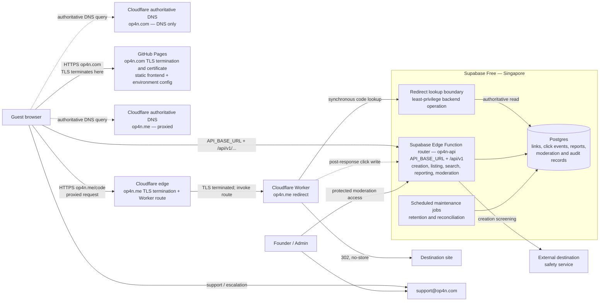

# R1 production architecture and service boundaries

- Status: Proposed for review
- Scope: R1 Create as Guest, Feature Inventory Batch 1, Order 1
- Decision owner and initial operator: Founder
- Public contact and escalation: `support@op4n.com`
- Related API contract: [R1 API contract and shared error model](../api/r1-api-contract.md)
- Last updated: 2026-11-08

## Purpose and scope

This decision record defines the production components, trust boundaries,
request paths, synchronous dependencies, failure isolation, and operating
ownership for the Op4n.com R1 public Guest experience. It is an architecture
contract, not an implementation of the APIs or infrastructure.

R1 covers anonymous canonical-link creation, redirects, aggregate click counts,
the Latest Links list, exact canonical-code search, reporting, and founder-run
Admin moderation. It does not add authentication, account ownership, custom
aliases, detailed analytics, Paid plans, Premium, pricing, or quotas.

The initial sizing assumptions are approximately 1,000 users, 1,000 new links
per day, and 10,000 redirects per day. The design must be exercised at a spike
of 100,000 redirects per day before launch. Numeric availability and latency
SLOs are owned by the separate
[R1 canonical redirect SLO](./r1-redirect-slo.md); this architecture keeps the
redirect path small and isolates optional work so those targets can be set and
measured without changing the service boundaries.

## Decisions

| ID | Decision | Consequence |
| --- | --- | --- |
| ADR-001 | Host the static frontend for `op4n.com` on GitHub Pages. | The public site has no server-side secrets or privileged logic. GitHub Pages terminates HTTPS and manages the `op4n.com` certificate. Deployments are versioned repository artifacts. |
| ADR-002 | Use Cloudflare as authoritative DNS for `op4n.com`, with its records set to DNS only. | Cloudflare answers DNS but does not proxy `op4n.com` traffic or terminate its TLS. The HTTPS connection goes to GitHub Pages. This record does not authorize changing live DNS. |
| ADR-003 | Proxy and route `op4n.me/{code}` through Cloudflare to a Cloudflare Worker. | HTTPS/TLS for `op4n.me` terminates at the Cloudflare edge, which invokes the redirect Worker. The short-link route is operationally separate from `op4n.com` hosting. |
| ADR-004 | Use Supabase Free in Singapore for Postgres and backend services. | R1 starts with one regional system of record and accepts that database or regional failure can stop lookup and mutation paths. |
| ADR-005 | Expose REST/JSON backend contracts under the versioned path `/api/v1`. The static frontend calls one environment-specific Supabase Edge Function router named `op4n-api` through `API_BASE_URL`. | `/api/v1` is a path contract, not a claim that GitHub Pages hosts the API. Order 6 defines the Supabase function URL shape, resource routes, exact CORS origins, and deployment validation without creating them. |
| ADR-006 | Return HTTP `302` for a successful short-link redirect and start with `Cache-Control: no-store`. | Destination and moderation changes take effect without relying on edge-cache invalidation. Every redirect performs an authoritative lookup. |
| ADR-007 | Generate random, non-sequential canonical codes and never reuse a code. | Codes do not disclose creation volume; deleted or retired codes remain tombstoned and cannot identify another destination later. |
| ADR-008 | Add no dedicated cache or queue initially. | Postgres is authoritative. Analytics writes run off the response-critical redirect path, but without a durable queue an analytics outage can create observable count gaps. Load and reliability tests decide whether a cache or queue is justified. |
| ADR-009 | The founder is the sole initial service owner, deployer, moderator, backup/restore operator, and contact owner. | Runbooks, alerts, and audit records must be usable by one operator; `support@op4n.com` is the single monitored R1 contact. |

## Architecture

The dashed Worker-to-API flow is non-blocking for the redirect response; the
other dashed arrows show DNS resolution, not HTTP proxying. There is no
dedicated R1 cache or queue. “Jobs” means scheduled, idempotent maintenance
invoked through the backend platform; it is not a separate always-on service.
`op4n.com` remains DNS only at Cloudflare, while GitHub Pages terminates its TLS.
The static frontend reads the non-secret, environment-specific `API_BASE_URL`
and calls the `op4n-api` router hosted by Supabase backend services. The
[Order 6 API contract](../api/r1-api-contract.md) defines the function URL
shape, `/api/v1` resources, environment placeholders, and exact CORS policy;
neither record creates or deploys them.

## Component boundaries and ownership

| Component | Responsibility | Must not do | Synchronous dependencies | Failure boundary | Initial owner |
| --- | --- | --- | --- | --- | --- |
| Cloudflare authoritative DNS for `op4n.com` | Publish DNS-only records that resolve the main site to GitHub Pages. | Proxy `op4n.com`, terminate its TLS, or contain application behavior. | Cloudflare authoritative DNS. | A DNS failure can prevent `op4n.com` resolution but does not transfer certificate or TLS responsibility from GitHub Pages and does not by itself stop a separately healthy `op4n.me` route. | Founder |
| GitHub Pages / `op4n.com` | Terminate HTTPS, manage the `op4n.com` certificate, and serve versioned HTML, CSS, JavaScript, public assets, and non-secret environment configuration including `API_BASE_URL`. | Host `/api/v1`, hold secrets, decide authorization, or write the database directly. | DNS resolution and GitHub Pages/CDN for page load; the browser calls the API origin separately for dynamic actions. | A Pages, certificate, or main-site TLS failure does not stop existing `op4n.me` redirects. | Founder |
| Cloudflare authoritative DNS for `op4n.me` | Publish the proxied short-domain record that resolves into Cloudflare's edge path. | Terminate TLS itself, proxy `op4n.com`, serve the main frontend, or contain product records. | Cloudflare authoritative DNS. | A short-domain DNS failure prevents `op4n.me` resolution but does not change where either domain terminates TLS. | Founder |
| Cloudflare edge for `op4n.me` | Receive the proxied request, terminate `op4n.me` HTTPS/TLS, and route matching requests to the Worker. | Terminate `op4n.com` TLS, serve the main frontend, or become an API-origin alias. | A resolved proxied record, Cloudflare edge TLS, and Worker routing. | An edge certificate, TLS, proxy, or route failure stops `op4n.me` requests without making GitHub Pages the redirect fallback. | Founder |
| Cloudflare Worker redirect service | Normalize a canonical code, request an authoritative lookup, return intentional unknown/disabled states or a `302`, and schedule click recording after the response. | Serve discovery, search, Admin UI, or treat a code as ownership proof. | Redirect lookup boundary and therefore Postgres; destination is not contacted by the service. | Analytics, Latest Links, search, reporting, and moderation UI failures do not block a valid redirect. Database lookup failure does. | Founder |
| Supabase Edge Function router / API origin | Host `op4n-api` per environment, expose the versioned `/api/v1` resource contracts, and separate public, founder, and internal service operations. The browser reaches it through `API_BASE_URL`. | Assume GitHub Pages hosts the API, accept wildcard/arbitrary-origin CORS, or expose internal redirect/click operations to browsers. | Supabase platform and Postgres; individual operations have the additional dependencies listed below. | API-origin failure can leave static `op4n.com` assets available while dynamic creation, listing, search, reporting, and Admin operations fail intentionally. | Founder |
| Creation API | Validate HTTP/HTTPS input, apply rate limits and safety screening, generate a random code, and create a Public read-only Guest link. | Grant Guest ownership or expose internal safety rules. | Postgres, rate-limit mechanism, and required safety decision. | Creation can fail closed without affecting redirect or read-only discovery. | Founder |
| Redirect lookup boundary | Return only the minimum redirect decision for one exact code: destination, active/disabled/unknown state, and safe response metadata. | Return Admin, report, click-detail, or private request data. | Postgres. | A narrow contract limits redirect exposure and prevents discovery failures from entering the path. | Founder |
| Click analytics | Append a minimized click event and maintain/reconcile the public aggregate total. | Delay or veto an otherwise valid redirect; expose detailed events publicly. | Postgres when the asynchronous write runs. | Failure is logged and alerted but does not change the issued `302`. Without a queue, outage-period events may be missing. | Founder |
| Latest Links | Return at most 100 newest eligible active Public and safety-approved links, with safe destination summaries. | Return Unlisted, disabled, deleted, unsafe, or protected data. | Postgres. | Listing failure affects discovery only. | Founder |
| Exact search | Normalize an accepted canonical URL/code and return one eligible Public link card or an intentional state. | Perform keyword or destination search. | Postgres. | Search failure does not affect redirect, creation, or Latest Links. | Founder |
| Reporting | Validate and store a public report and provide a non-sensitive receipt. Notify/escalate through the central contact workflow. | Reveal screening or moderation logic. | Postgres; notification delivery may be asynchronous/best-effort. | Notification failure must not lose the persisted report; redirect remains active until a moderation decision changes it. | Founder |
| Admin moderation | Let the founder locate a link, record a reason, disable or restore it, and retain an audit record. | Trust a short code alone or expose Admin operations publicly. | Protected Admin access and Postgres. | Admin UI failure does not alter current redirect state; database failure blocks moderation safely. | Founder |
| Postgres | Authoritative links, never-reused codes/tombstones, click events/aggregates, reports, moderation state, and audit records. | Be reachable from the public browser with privileged credentials. | Supabase Singapore region. | It is the intentional shared state dependency and primary R1 single point of failure. | Founder |
| Scheduled jobs | Run retention, aggregate reconciliation, and operational checks idempotently. | Sit on the request-critical redirect path. | Postgres and platform scheduler. | A delayed job may make derived counts stale but does not stop redirect. | Founder |
| External safety service | Return a bounded destination risk decision used by creation and later review. | Receive more user or link data than necessary. | External provider network/API during required screening. | Creation fails closed or returns a retryable state; existing active redirects continue unless moderation changes them. | Founder |

## Trust boundaries and data classification

1. **Public internet to static site.** Everything shipped by GitHub Pages is
   public and untrusted at the API boundary. Browser validation is usability,
   not a security control.
2. **Public internet to redirect edge.** The path segment, headers, and request
   metadata are untrusted. The Worker accepts only the canonical code shape,
   uses bounded timeouts, and returns no internal error details.
3. **Public clients to the API origin.** The static frontend reads
   `API_BASE_URL` from non-secret environment configuration and appends the
   versioned `/api/v1` path. Supabase backend services, not GitHub Pages, host
   the API operations. Creation, Latest Links, exact search, and report
   endpoints are public but rate-limited, schema-validated, and output-encoded.
   They require no user JWT; a supplied token grants no extra capability.
   They use only public/anonymous database capabilities exposed through backend
   operations, never a privileged key in the browser. Order 6 defines the
   environment-specific function URL shape, resource routes, and exact CORS
   matrix in the linked API contract.
4. **Worker/backend to Supabase.** The Worker uses a rotatable custom
   environment service credential restricted to internal operations, never a
   Supabase Publishable/Secret key or founder JWT as its bearer credential.
   Redirect lookup can read only the fields needed to decide the response;
   public APIs cannot use an unrestricted service role.
5. **Admin boundary.** Moderation is protected separately from Guest APIs.
   A Supabase Auth user JWT must pass signature, issuer, audience, time,
   environment, and stable-subject allowlist checks for every founder request;
   mutations are audited. No static founder bearer is shipped to the browser.
   A short URL or code is never authorization.
6. **External provider boundary.** Safety requests send the minimum destination
   information and use a server-held credential. Provider responses are
   untrusted input and cannot directly mutate link state.

Public data is limited to the active eligible link's Title, canonical short URL,
safe destination summary (normalized origin plus only a server-approved or
redacted path, with origin-only fallback and no user info, query, or fragment), and
aggregate total click count. The full destination is protected service data: it
is used to perform the Open/redirect action but is not returned in public
listing or search payloads. Protected data also includes full destination query
and fragment, raw click events, network identifiers, rate-limit state, reports,
safety results, moderation reasons, audit records, Admin identity, credentials,
backups, and operational logs. Logs must redact URLs, secrets, and unnecessary
request identifiers.

## Request flows

### Create link

1. The browser loads static assets and non-secret environment configuration
   from GitHub Pages at `op4n.com`, then sends JSON to the creation endpoint
   beneath `${API_BASE_URL}/api/v1`. Supabase backend services host this
   operation; GitHub Pages does not proxy or serve it. Order 6 defines
   `POST /api/v1/links`.
2. The API validates schema and accepts only supported HTTP/HTTPS destinations,
   applies rate limits, normalizes the destination, and requests the required
   safety decision.
3. After approval it generates a cryptographically random, non-sequential code
   and inserts the link transactionally. A unique constraint handles collision
   by generating a new code; a used code is never reclaimed.
4. The API returns the public read-only representation. A failure before commit
   returns an intentional error and creates no partial link.

Synchronous path: API → validation/rate limit → safety service → Postgres. The
frontend and redirect service remain available if creation is degraded.

### Redirect and click recording

1. Cloudflare routes `https://op4n.me/{code}` to the Worker.
2. The Worker validates the code and performs one bounded authoritative lookup.
3. Unknown and disabled results receive distinct intentional responses. An
   active result receives `302 Location: <protected full destination>` with
   `Cache-Control: no-store`.
4. The Worker schedules the click-event write after the response using the
   platform's request-lifetime extension mechanism. Analytics errors are logged
   and alerted; they do not replace the `302`.

Synchronous path: Worker → redirect lookup → Postgres. Analytics, Latest Links,
search, reporting, safety provider, and GitHub Pages are not synchronous redirect
dependencies. In normal operation every successful redirect appends an event.
With no durable queue, an analytics/database-write outage can lose an event; R1
prefers a working redirect and makes the gap observable. A durable queue is the
first candidate only if load or reliability tests show this trade-off is no
longer acceptable.

### Public Latest Links

1. The browser calls the Latest Links endpoint beneath
   `${API_BASE_URL}/api/v1` on Supabase backend services through the Order 6
   `GET /api/v1/links` contract.
2. The API queries only active, Public, safety-approved records, newest first,
   and returns public fields plus aggregate counts.
3. Timeout or database error produces a visible discovery error without
   changing creation or redirect state.

### Exact search

1. The browser sends a canonical URL, host/path, or code to an exact-search
   endpoint under `${API_BASE_URL}/api/v1` on Supabase backend services.
2. The API normalizes to one canonical code and performs an exact match.
3. Only an eligible Public record returns the public card. No result, disabled,
   and service error remain distinct states without exposing protected details.

### Report

1. A public card sends a bounded reason and canonical-link identifier to the
   `POST /api/v1/links/{code}/reports` endpoint on Supabase backend services.
2. The API validates, rate-limits, and persists the report before acknowledging
   it. It returns no sensitive moderation state.
3. Follow-up notification/escalation routes to `support@op4n.com`. Delivery
   failure is retried or surfaced operationally without discarding the stored
   report or synchronously changing redirect behavior.

### Moderation

1. The founder crosses the protected Admin boundary and retrieves the report or
   exact link using a privileged backend operation.
2. Disable/restore and its reason are committed together with an immutable audit
   record.
3. The next uncached redirect lookup observes the new state. A failed transaction
   leaves the prior state intact and reports an actionable error to the founder.

## Failure isolation and degradation policy

| Failure | User-visible effect | Must remain available | Operator response |
| --- | --- | --- | --- |
| Cloudflare authoritative DNS for `op4n.com` unavailable or misconfigured | The DNS-only main-site name may not resolve; Cloudflare is not in its HTTP/TLS path. | Existing `op4n.me` redirects if their separate DNS/edge path is healthy. | Restore the versioned DNS-only records; do not enable proxying as a workaround. |
| GitHub Pages, its certificate, or `op4n.com` TLS unavailable | Main site cannot load over HTTPS. | Existing short-link redirects. | Check Pages deployment, custom-domain, and certificate status; roll back the static release if caused by a deploy. |
| Supabase public API origin unavailable | Static main-site assets can load, but creation, Latest Links, exact search, reporting, and Admin API actions fail intentionally. | Existing redirect when its separate lookup path and Postgres are healthy. | Inspect Supabase backend health and configuration; do not repoint `/api/v1` to GitHub Pages. |
| Creation API or safety service unavailable | No new link; preserve form data and show retryable/blocked state. | Existing redirects, and unaffected public reads. | Inspect API/provider health; fail creation closed. |
| Click write or aggregation unavailable | Redirect succeeds; public count may be stale or incomplete. | Redirect, lookup, and unrelated APIs. | Alert, record outage window, restore writes, reconcile what can be reconciled, and disclose known gaps internally. |
| Latest Links unavailable | Discovery shows an explicit error. | Redirect, creation, exact search where healthy. | Repair query/API independently; do not change redirect. |
| Exact search unavailable | Search shows an explicit error. | Direct redirect, creation, Latest Links where healthy. | Repair search path independently. |
| Reporting notification unavailable | Persisted report is acknowledged; follow-up is delayed. | Redirect and stored report. | Monitor stored reports and central contact; retry notification. |
| Admin surface unavailable | Founder cannot moderate until restored. | Current redirect decisions remain unchanged. | Use the documented protected break-glass database procedure only when authorized and audit it afterward. |
| Postgres or Singapore region unavailable | Creation, redirect lookup, public reads, reports, and moderation fail intentionally. | Static `op4n.com` assets only. | Declare incident, avoid speculative writes, restore service or approved backup, then verify invariants. |
| Cloudflare authoritative DNS for `op4n.me` unavailable or misconfigured | The short domain does not resolve into the proxied edge path. | Static `op4n.com` if its DNS-only record and GitHub Pages path are healthy; Supabase data. | Restore the versioned proxied DNS record; do not change `op4n.com` proxy mode. |
| Cloudflare `op4n.me` edge TLS/proxy, Worker route, or Worker unavailable | The short domain may resolve, but its HTTPS redirect path fails. | Static `op4n.com` if its DNS-only record and GitHub Pages path are healthy; Supabase data. | Roll back the affected edge certificate/configuration, Worker route, or Worker using the versioned known-good state; do not move TLS to GitHub Pages. |

Timeout, retry, and circuit-breaker values belong in implementation/configuration,
but retries must be bounded and safe. Mutations require idempotency or a request
identifier before automatic retry. Public errors use stable codes and correlation
IDs, not stack traces or provider details.

## Security and secrets

- Enforce HTTPS, schema and size limits, output encoding, supported-protocol
  validation, and rate limits at the appropriate edge/backend boundary. The
  Order 6 contract defines the API function URL shape, resource routes, and
  exact CORS configuration without deploying them.
- Use separate least-privilege credentials for redirect lookup, public API
  operations, scheduled jobs, and Admin operations. Prefer platform-managed
  secret stores; never put production credentials in Git, frontend assets,
  examples, issue text, logs, or build output.
- Keep the Supabase privileged/service role server-side. Public browser code may
  receive only a deliberately public key and only when row-level security and
  backend policy make that safe; the preferred R1 boundary is the `/api/v1`
  service rather than direct table access.
- Protect Admin operations with strong founder identity, multi-factor
  authentication, least privilege, and audited actions. Document credential
  rotation and emergency revocation before launch.
- Minimize click/request collection, define retention before enabling it, and
  never expose raw events, IP/device data, reports, moderation details, or
  safety signals through public APIs.
- Route public support, abuse, privacy, and operations escalation to the single
  monitored `support@op4n.com` inbox. The founder owns triage and follow-up.

## Backup, migration, deployment, and rollback boundaries

### Backup and restore

Postgres is the system of record. Before production data exists, the founder must
document and test a restore procedure compatible with the Supabase plan, including
an encrypted export or supported backup outside the live database, access
control, retention, integrity checks, and a restore rehearsal. Exact RPO/RTO and
backup cadence belong to the dedicated backup decision. A provider feature is
not considered a verified backup until a restore test passes. Cloudflare DNS
configuration, including DNS-only `op4n.com` and proxied `op4n.me` records,
Cloudflare edge/Worker configuration, Supabase configuration/policies, and
GitHub Pages custom-domain/certificate settings must also be captured as
versioned infrastructure/configuration or an auditable runbook; database backup
alone cannot reconstruct the service.

### Database migrations

- Store ordered, reviewable, forward migrations in version control; apply them
  once per environment with recorded versions and no embedded secrets.
- Prefer expand/contract changes: deploy additive schema first, deploy compatible
  readers/writers second, backfill with bounded jobs, and remove old fields only
  after verification.
- Never reuse codes or erase audit/tombstone evidence as a migration shortcut.
- Test migration and restore against production-shaped non-sensitive data before
  production. Take/verify a recovery point before a destructive migration.
- A migration failure stops deployment. Roll forward is preferred after data
  mutation; restore is an explicit incident decision, not an automatic script.

### Deployment

The static frontend on GitHub Pages, Supabase backend services that provide the
`/api/v1` path contract, database migrations, and Cloudflare Worker are separate
deployable boundaries. The static deployment provides a non-secret
environment-specific `API_BASE_URL`; it does not host the API. Each release
records the Git commit, artifact/config version, migration version, operator,
verification result, and time. Deploy database-compatible changes before
dependent code. Run smoke checks for create, active/unknown/disabled redirect,
aggregate count, Latest Links, exact search, report persistence, and moderation
in a non-production environment, then run safe production health checks. One
founder may perform all roles in R1, but must still use a written checklist and
retain evidence.

### Rollback

- GitHub Pages: redeploy the last known-good static artifact and non-secret
  environment configuration; this does not roll back backend data, change the
  DNS-only proxy mode, or move API hosting to Pages.
- Cloudflare Worker: redeploy the last known-good Worker and route/config version;
  verify `302`, `no-store`, unknown, and disabled behavior.
- Backend: redeploy the last compatible function/API artifact. Keep at least one
  prior version compatible during the release window.
- Database: do not assume application rollback reverses schema or data. Use
  expand/contract compatibility, a tested corrective migration, or an explicitly
  approved restore based on incident impact and the backup decision.
- Configuration/secrets: version non-secret configuration, retain an auditable
  previous value, rotate compromised secrets forward, and never restore a known
  compromised credential.

Rollback success means the public redirect path and data invariants are verified,
not merely that a deployment command completed.

## Load and verification gates

Before R1 production launch, verify the architecture with representative and
spike tests, without placing real destinations or personal data in fixtures:

- creation at the expected 1,000 links/day profile, including rate limits,
  collision handling, safety timeout, idempotent retry, and partial-failure checks;
- redirect at the expected 10,000/day profile and a 100,000/day spike profile,
  measuring lookup latency, error rate, database connections, and Worker limits;
- fault injection showing a valid redirect still returns `302` with `no-store`
  when click recording, aggregation, Latest Links, or exact search is failing;
- intentional unknown and disabled states that do not leak protected details;
- listing/search filters that exclude Unlisted, disabled, deleted, unsafe, and
  ineligible reported links and never expose query strings or fragments;
- report persistence before acknowledgement and audited Admin disable/restore;
- secret scanning, dependency review, least-privilege checks, migration rehearsal,
  backup integrity, restore rehearsal, deploy smoke test, and rollback rehearsal.

Test evidence determines whether a dedicated cache, durable queue, a different
Supabase plan, or another regional/availability control is needed. Those are
explicit follow-up decisions, not implicit additions to Order 1.

## Acceptance-criteria traceability

| Criterion | Evidence in this record |
| --- | --- |
| Architecture diagram identifies every component and data flow. | Architecture diagram plus component table and request flows. |
| Synchronous dependencies and failure boundaries are explicit. | Component table, per-flow dependency statements, and degradation matrix. |
| Every component has an owner. | Founder ownership is recorded for every row; central escalation is `support@op4n.com`. |
| Redirect is independent from analytics and discovery failures. | Redirect flow contains only Worker, redirect lookup, and Postgres; analytics is post-response and discovery paths are separate. |
| R1 SLO, security, backup, and rollback needs are supported. | Small uncached redirect path, load/fault gates, security and secrets controls, and explicit backup/migration/deploy/rollback boundaries. Numeric SLO and RPO/RTO values remain in their dedicated R1 decisions. |
| DNS/TLS and API-origin boundaries match the reviewed deployment model. | `op4n.com` is DNS only at Cloudflare with TLS at GitHub Pages; `op4n.me` is proxied with TLS at Cloudflare edge. The frontend calls the environment `op4n-api` Supabase router via `API_BASE_URL`; Order 6 defines its function URL shape, routes, and exact CORS policy without deploying them. |
| Product Plan and approved decisions are preserved. | R1-only scope, public/protected data rules, Guest invariants, 302/no-store, random never-reused codes, Singapore Supabase, and no initial cache/queue are all explicit. |

## Deferred decisions and triggers

This record does not authorize implementing later Feature Inventory cards. The
following remain separate implementation decisions: numeric redirect SLO,
deployment of the approved API/error contracts and CORS configuration,
[production database schema and invariants](./r1-database-schema.md), analytics retention,
[Staging and Production separation](./r1-environment-strategy.md), backup RPO/RTO,
dashboards/alerts, and secrets implementation. The API-origin contract is owned
by Order 6; its live implementation remains a later card.

A cache may be proposed only if load tests show authoritative reads cannot meet
the approved redirect SLO or platform limits. A durable queue may be proposed if
fault testing or production evidence shows analytics loss/retry requirements
cannot be met by post-response writes. Either change requires a new decision
covering invalidation or delivery semantics, cost, security, operations, and
rollback; neither changes the rule that redirect availability is isolated from
analytics and discovery.
