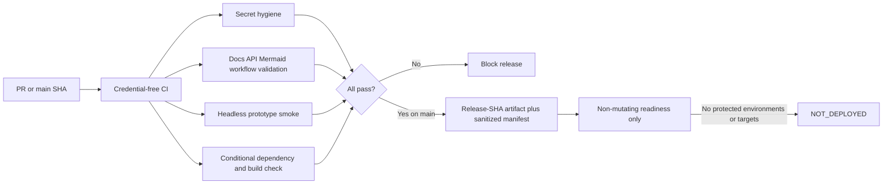
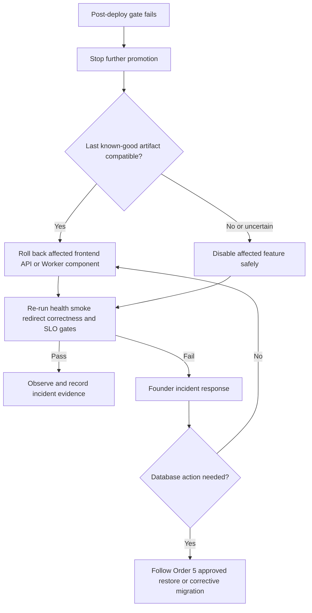

# R1 CI/CD quality gates and production rollback

- Status: Proposed for review
- Scope: Feature Inventory R1, Batch 1, Order 8
- Decision owner and sole initial operator: Founder
- Last updated: 2026-11-08
- Related foundation: [production architecture](../architecture/r1-production-architecture.md), [redirect SLO](../architecture/r1-redirect-slo.md), [environment strategy](../architecture/r1-environment-strategy.md), [database migration process](../architecture/r1-database-migration-process.md), [API contract](../api/r1-api-contract.md), and [secrets/access](../security/r1-secrets-and-access.md)

## Purpose and activation boundary

This record defines executable credential-free CI, a non-mutating release
candidate, fail-closed deployment readiness, and component rollback. It creates
no GitHub Environment, secret, provider target, DNS record, Worker route,
Supabase project, database change, or deployment.

CI is enabled by `.github/workflows/ci.yml` for pull requests, `main`, and
manual verification. `.github/workflows/deployment-readiness.yml` is explicitly
`READINESS_ONLY`: it has no `environment:` binding, no secret reference, no
provider command, and always reports `NOT_DEPLOYED`. This prevents GitHub from
implicitly creating an unprotected Environment. Skipping or passing this dry
run is not a Staging or Production deployment.

Actual deployment remains blocked until the founder configures and verifies
separate protected `Staging` and `Production` GitHub Environments and provider
targets under Orders 3, 5, 6, and 7. That later activation requires review of a
workflow change; it must never be achieved by adding a fallback in this record.

## Quality-gate flow



The local and CI entrypoints are identical:

```text
npm ci --ignore-scripts --no-audit
node tests/dependency-build-check.mjs
node tests/secret-hygiene.mjs
node tests/foundation-validation.mjs
node tests/deployment-readiness.mjs --self-test
node tests/release-artifact.mjs --self-test
node tests/run-prototype-smoke.mjs
node tests/release-artifact.mjs .ci-artifacts <exact-release-sha>
git diff --check
```

The smoke runner starts an ephemeral loopback-only static server and an
isolated headless Chrome profile, invokes the existing product assertions, then
removes the profile. It changes no product behavior or UI. Output is limited to
test names, counts, release SHA, content digest, and `NOT_DEPLOYED`; it must not
print a credential, secret-derived value, connection string, provider project
identifier, request body, or protected destination.

## Workflow security and concurrency

| Path | Trigger | Permission | Credential boundary | Concurrency |
| --- | --- | --- | --- | --- |
| CI | PR, push to `main`, manual | `contents: read` | No Environment, provider, Staging, or Production secret | Same PR/ref may cancel an obsolete CI run. |
| Deployment readiness | Manual only | `contents: read` | No Environment or secret; no provider operation | One target readiness run at a time; `cancel-in-progress: false`. |
| Future Staging deploy | Not enabled | Minimum reviewed permissions plus only Staging Environment credentials | Exact Staging target and reciprocal-negative check | Queue; never cancel an in-progress deployment. |
| Future Production promotion | Not enabled | Minimum reviewed permissions plus only Production Environment credentials | Exact Production target after founder approval | Queue; never cancel an in-progress deployment. |

Every external Action is pinned to a reviewed 40-character commit SHA with a
version comment. Checkout does not persist the GitHub credential. CI must never
use a fork-PR secret, `pull_request_target`, hosted-environment credential, or
write permission. `package.json` pins the semantic validators to exact versions,
requires Node 24.15.0 or newer, and `package-lock.json` is the sole install graph
used by `npm ci`. A manifest
without its matching lockfile fails closed.

## Semantic validation and structural policy checks

These are independent gates and neither is described as the other:

- **Semantic OpenAPI validation** uses the dependency-locked Redocly CLI against
  OpenAPI 3.1. It resolves every `$ref` and rejects invalid schemas, media-type
  and parameter examples, missing/duplicate operation IDs, and invalid document
  structure. The repository policy layer separately confirms the approved 12
  operations and absence of status `425`.
- **Semantic Mermaid validation** parses every `mermaid` fence with the pinned
  Mermaid parser in a deterministic Node DOM. It does not merely count fences
  or inspect the first keyword.
- **Semantic workflow YAML validation** parses both workflows with the pinned
  YAML parser using duplicate-key rejection. The policy layer then checks exact
  top-level permissions, full-SHA Action pins, concurrency, no secret reference,
  no accidental `environment:`, and the readiness-only markers.
- **Markdown/repository policy validation** checks fence closure, permitted hard
  breaks, and every relative link. These checks do not claim to be a semantic
  OpenAPI, Mermaid, or GitHub Actions schema validator.

Committed negative fixtures prove rejection of an unresolved OpenAPI reference,
invalid OpenAPI example, duplicate operation ID, malformed Mermaid source, and
malformed/duplicate-unsafe YAML. A future validator upgrade changes both the
exact package version and lockfile only after compatibility review and these
positive and negative cases pass.

## Release identity and evidence

`tests/release-artifact.mjs` accepts only an exact 40-character commit SHA. It
reads `tests/static-site-files.json` from that commit's Git blob, then reads every
approved site file from the same commit's Git tree/blob objects. It never reads
artifact bytes from the working tree. The sorted explicit allowlist means a new
repository file cannot enter an artifact until the allowlist change is reviewed.
Markdown, docs, tests, workflows, and any path outside the approved static roots
are rejected. Every entry must be a regular non-executable `100644` blob;
symlinks, executable modes, missing/ambiguous entries, traversal, backslashes,
and unexpected roots fail closed.

The sanitized manifest contains:

- full release SHA and commit time normalized to ISO UTC `Z`;
- deterministic SHA-256 digest of ordered file paths, modes, hashes, and sizes;
- Git object ID, mode, per-file SHA-256, and byte size; and
- explicit `deploymentState: NOT_DEPLOYED`.

The artifact self-test creates an isolated Git fixture, builds one commit twice
before and after dirtying an allowlisted working-tree file and adding an
unapproved file, and requires byte-for-byte identical outputs and digest. It
also requires a symlink and an unexpected allowlist path to be rejected. The
self-test touches neither the project working tree nor a hosted environment.

The CI artifact name includes the release SHA. An artifact is acceptable only
when the downloaded bytes reproduce the manifest digest and the workflow run
belongs to that SHA. Expired artifacts are missing evidence and block release;
they are not rebuilt under a different SHA and called equivalent. The future
durable release manifest must follow the sanitized, version-controlled evidence
rules from Order 5; expiring Actions artifacts and logs are not its only copy.

## Staging and Production activation gate

The future mutating workflows must be separate jobs bound to exact protected
GitHub Environments. They must prove the expected environment and target using
protected configuration without printing identifiers, and must prove reciprocal
credential denial. No missing variable, placeholder, stale health result,
skipped job, ambiguous target, or unavailable approval may degrade to a warning.
There is no Staging-to-Production or Production-to-Staging fallback.

The sequence is:

1. Select one full release SHA and artifact digest produced by passing `main` CI.
2. Queue a Staging deployment; verify target identity, configuration, platform
   health, active Supabase project, migration/recovery gate, and credential scope.
3. Deploy that immutable artifact to Staging and record sanitized evidence.
4. Run end-to-end Staging smoke, API readiness, canonical redirect destination
   correctness, analytics isolation, and the release gates from the redirect SLO.
5. Freeze the exact Staging SHA, digest, configuration version, migration set,
   evidence timestamps, and workflow/run reference in the release manifest.
6. Founder explicitly promotes that identity through the protected Production
   Environment. If repository visibility/plan cannot enforce approval, block.
7. After approval, revalidate all mutable health, configuration, migration,
   recovery, smoke, redirect-correctness, and SLO evidence. Evidence older than
   its reviewed TTL, missing, skipped, or ambiguous blocks before mutation.
8. Deploy components in their reviewed compatibility order, then repeat the
   post-deploy checks and retain sanitized evidence.

The current readiness workflow exercises only identity and fail-closed rules.
It cannot satisfy steps 2–8 and must never be represented as successful deploy.

## Rollback and feature shutdown



- Frontend rollback restores the last known-good GitHub Pages artifact compatible
  with the current API/configuration; it does not change DNS or proxy mode.
- API or Worker rollback restores only the affected versioned artifact and its
  compatible configuration. Never guess a route or target and never move
  `op4n.com` TLS/proxy responsibility.
- A rollback manifest records incident ID, component, bad and restored SHA/digest,
  compatibility evidence, UTC timestamps, operator, checks, and outcome without
  provider identifiers or protected data.
- Database migration is never reversed or restored automatically. Code rollback
  is not database rollback. Any corrective migration or approved restore follows
  Order 5, including recovery-point and attended-release requirements.
- If no compatible application artifact exists, shut down creation, discovery,
  analytics, reporting, or Admin mutation independently as appropriate. Preserve
  the canonical redirect path whenever it is correct and safe. If redirect
  correctness is uncertain, fail closed rather than emit a guessed destination.
- One incorrect destination opens a critical incident immediately. Rollback does
  not close it until authoritative mapping and synthetic correctness pass.

`tests/deployment-readiness.mjs --self-test` provides synthetic evidence that
missing/skipped/stale evidence, mismatched Staging/Production identities,
missing founder approval, and automated database reversal all fail closed. It
does not contact or mutate a real environment.

## Operator checklist

- [ ] Exact release SHA and artifact digest are recorded and reproducible.
- [ ] Required CI checks passed on that SHA; none are skipped or stale.
- [ ] Target and credential reciprocal-negative checks passed without logging IDs.
- [ ] Staging deployment and post-deploy evidence belong to the same identity.
- [ ] Founder approval is enforceable and recorded before Production starts.
- [ ] Mutable Production preflight was rerun after approval.
- [ ] Component order is schema/config compatible and rollback candidates exist.
- [ ] Post-deploy health, smoke, redirect correctness, and SLO gates passed.
- [ ] Sanitized durable manifest is retained; expiring logs are supplemental only.
- [ ] Any rollback or shutdown is attended, bounded, verified, and recorded.

## Acceptance-criteria traceability

| Acceptance criterion | Evidence |
| --- | --- |
| PR and `main` run reproducible credential-free gates with minimum permissions and pinned Actions. | CI workflow, common Node entrypoints, action-pin validator. |
| Secret hygiene, repository/docs/API/Mermaid, smoke, and locked dependency/build checks run. | CI steps, exact package versions/lockfile, semantic validators, structural policy checks, and negative fixtures. |
| CI may cancel obsolete work; deployment cannot. | Separate concurrency policies and structural tests. |
| Separate target/credential boundaries, exact immutable identity, and Production promotion are defined. | Git-object-only allowlisted artifact, reproducibility self-test, activation gate, release manifest, and workflow dry-run identity checks. |
| Unconfigured GitHub Environments cannot be created or used accidentally. | Readiness workflow has no `environment:`/secret/provider command and emits `NOT_DEPLOYED`. |
| Missing, stale, skipped, mismatched, or ambiguous evidence blocks. | Readiness self-tests and activation rules. |
| Rollback is component-bounded and database recovery follows Order 5 only. | Rollback decision tree and runbook. |
| Rollback path is verified without touching real systems. | Synthetic fail-closed self-tests and readiness-only workflow. |

## Principal PO/Architect review

Review should confirm the readiness-only boundary while GitHub Environments are
absent; the future activation sequence and evidence TTL; immutable artifact
allowlist; action versions/pins; provider-neutral target proof; component
rollback order; feature-shutdown policy; and the rule that database recovery is
never automatic. Approval of this record does not authorize deployment or
environment/provider creation.
